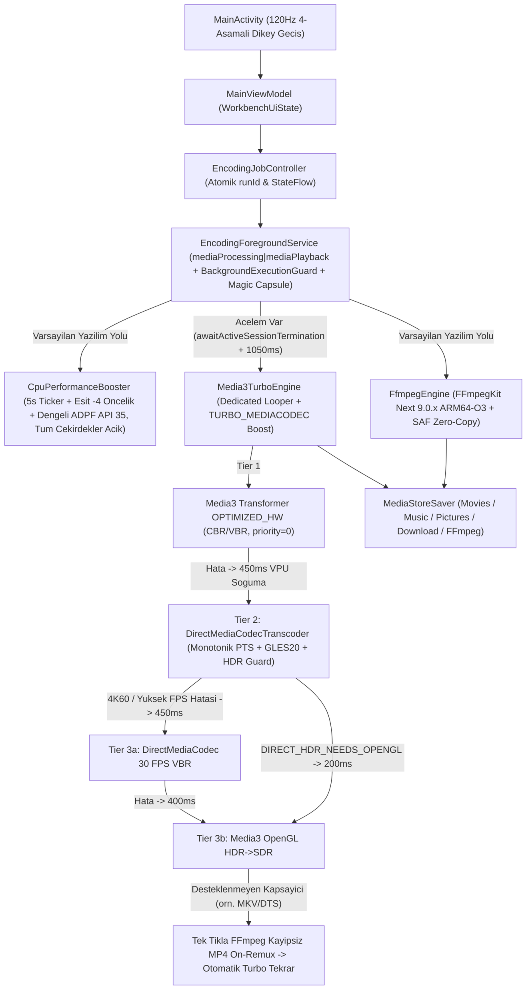

# FFmpeg Compressor & Editor — Yapay Zeka Ajanı Geliştirme ve Devir Teslim Kılavuzu (`AGENTS.md`)

Bu doküman, **`Cres246/FFmpeg-compressor-editor`** projesini devralan yapay zeka ajanlarının önceki geliştirme sürecindeki tüm mimari kararları, FFmpeg/Media3 kurallarını, çözülen hataları, kullanıcı arayüzü tercihlerini, kesinlikle yapılmaması gerekenleri ve sıradaki adımları eksiksiz şekilde okuyup kaldığı yerden devam edebilmesi için hazırlanmıştır.

---

## 1. Proje Kimliği, Kökeni ve Mevcut Durum

### 1.1 Köken (Termux Betiğinden Yerel Android Uygulamasına)
1. **Faz 1 — Termux Betiği (`~/bin/termux-file-editor`):** Proje ilk olarak Android üzerinde yerel ARM64 FFmpeg gücünü kullanan 10 modlu etkileşimli bir Bash betiği ([`betik_308d5669.txt`](public/assets/aistudio/betik_308d5669.txt), tasarım arşivi [`Android___in_Kay_ps_z_Video_D_n___m__9bf11cd7.json`](public/assets/aistudio/Android___in_Kay_ps_z_Video_D_n___m__9bf11cd7.json)) olarak 40+ revizyonla olgunlaştırıldı.
2. **Faz 2 — Yerel Android Uygulaması (`b7ecbfe` → güncel):** Betikteki tüm 2-Pass bit hızı matematiği, milisaniyelik keyframe tarayıcısı, 3 yönlü çözünürlük ölçekleyicisi ve sıfır çöp dosya (zero-bloat) kuralları birebir korunarak **Kotlin + Jetpack Compose + GPL FFmpegKit + Jetpack Media3 Transformer + Direct OpenGL/MediaCodec** tabanlı yerel bir Android uygulamasına taşındı. İlk prototipteki mavi/camgöbeği `"FFLab"` kimliği terk edilerek sıcak krem ve koyu çello kahvesi tonlarında editoryal **"FFmpeg"** tasarım sistemine geçildi.

### 1.2 Teknik Künye
* **Uygulama Kimliği & Namespace:** `applicationId = "com.aistudio.fflab.vktmpx"`, `namespace = "com.example"` ([`app/build.gradle.kts`](app/build.gradle.kts))
* **SDK & Derleme Zinciri:** `minSdk = 24` (Android 7.0), `targetSdk = 36`, `compileSdk = 36.1`, AGP `9.1.1`, Kotlin `2.4.21`, Java `11`, 16 KB sayfa hizalaması hazır (`jniLibs.useLegacyPackaging = false`) ([`gradle/libs.versions.toml`](gradle/libs.versions.toml))
* **3 Katmanlı Hibrit Medya Motoru:**
  1. **Yazılım Motoru (Varsayılan / Tam Kalite):** Resmi **`arthenica/ffmpeg-kit-next`** (FFmpeg 9.0.x + `libx264`, `libx265`, `libmp3lame`, `ffprobe`, `arm64-v8a` `-O3` runtime-dispatched `NEON/DotProd/I8MM`, Nix `./nix-android.sh` ile GitHub Actions üzerinde tek motor olarak derlenir; yalnızca Nix'siz AI Studio önizlemesinde `dev.ffmpegkit-maintained:ffmpeg-kit-full-gpl:8.1.9` yerel geliştirme bağımlılığı devrededir) — [`FfmpegEngine.kt`](app/src/main/java/com/example/data/FfmpegEngine.kt)
  2. **Donanım Motoru — Tier 1 & 3b:** `androidx.media3:media3-transformer:1.11.1` + `media3-effect` — [`Media3TurboEngine.kt`](app/src/main/java/com/example/data/Media3TurboEngine.kt)
  3. **Donanım Motoru — Tier 2 & 3a:** Sıfır bağımlılıklı yerel `MediaExtractor` → `MediaCodec` (HW Decoder) → `EGL14` / `GLES20` (`SurfaceTexture`) → `MediaCodec` (HW Encoder) → `MediaMuxer` hattı — [`DirectMediaCodecTranscoder.kt`](app/src/main/java/com/example/data/DirectMediaCodecTranscoder.kt)
* **Birincil Hedef Test Cihazı Profili:** **Honor (MagicOS / Android 16, Snapdragon / Qualcomm `c2.qti.*` VPU, 120Hz ekran, Honor Magic Capsule)**. Bildirim tasarımı, yenileme hızı kilidi, Prime çekirdek önceliklendirmesi ve donanım VPU soğuma süreleri bu gerçek donanım davranışlarına göre doğrulanmıştır.

### 1.3 Mevcut 11 İşleme Modu ([`MediaModels.kt`](app/src/main/java/com/example/domain/MediaModels.kt))
Termux betiğindeki 10 moda `9f271be` commit'inde **03 · Gmail (`< 25 MB`)** eklenmiş ve toplam mod sayısı 11 olmuştur:

| No | Enum (`ProcessingMode`) | Kategori | Çıktı Şablonu | Teknik Davranış | Turbo (`MediaCodec`) |
| :---: | :--- | :--- | :--- | :--- | :---: |
| **01** | `DISCORD_20MB` | Hedef Boyut | `*_H264_20MB.mp4` | `< 20 MB` gerçek 2-Pass ABR | Evet |
| **02** | `WHATSAPP_100MB` | Hedef Boyut | `*_H264_100MB.mp4` | `< 100 MB` gerçek 2-Pass ABR | Evet |
| **03** | `GMAIL_25MB` | Hedef Boyut | `*_H264_25MB.mp4` | `< 25 MB` gerçek 2-Pass ABR | Evet |
| **04** | `CUSTOM_SIZE` | Hedef Boyut | `*_<MB>MB.mp4` | Kullanıcı MB hedefi (varsayılan `8 MB`) · 2-Pass ABR | Evet |
| **05** | `TRIM_VIDEO` | Videoyu Kes | `*_Kesit*.mp4` / `*_Clip*.mp4` | Keyframe taramalı 4 alt mod (1–2 kayıpsız, 3–4 hassas CRF) | Sadece Alt Mod 3 & 4 |
| **06** | `REMUX_FORMAT` | Daha Fazla | `*_Remux.mp4` | `-sn -dn -c copy -movflags +faststart` (%100 kayıpsız kutu yenileme) | Hayır (Zaten anlık) |
| **07** | `EXTRACT_AUDIO` | Daha Fazla | `*_Orijinal.<ext>` / `*_Ses*.m4a\|mp3` | `-vn -sn -dn`; kaynak zaten hedef kodekse otomatik `-c:a copy` | Hayır |
| **08** | `AUDIO_ONLY_AAC` | Daha Fazla | `*_AAC_<k>k.mp4` | `-c:v copy -c:a aac` (Görüntü %100 kayıpsız, ses AAC; varsayılan `256k`) | Hayır |
| **09** | `VIDEO_ONLY_CRF` | Daha Fazla | `*_<CODEC>_CRF16\|20.mp4` | Video `CRF 16` (H.264) / `CRF 20` (H.265) + `-c:a copy` | Evet |
| **10** | `VIDEO_AND_AUDIO_CRF` | Daha Fazla | `*_<CODEC>_CRF16\|20_AAC_<k>k.mp4` | Video `CRF 16/20` + Ses AAC (`256k` varsayılan) | Evet |
| **11** | `CUSTOM_COMMAND` | Daha Fazla | Komutta belirtilen ad | Yapay zekadan kopyalanmış ham/çok adımlı (`&&`) FFmpeg komutları | Hayır |

---

## 2. Mimari Kararlar



### 2.1 4 Katmanlı Paket Yapısı (`app/src/main/java/com/example/`)
* **`domain/` (Saf İş Mantığı):**
  * [`MediaModels.kt`](app/src/main/java/com/example/domain/MediaModels.kt): Tüm domain modelleri, 11 mod, kesim alt modları ve `EncodingState` (`Idle`, `Running`, `Success`, `Failed`).
  * [`FfmpegMath.kt`](app/src/main/java/com/example/domain/FfmpegMath.kt): 2-Pass bit hızı hesabı, 3 yönlü çözünürlük filtreleri, keyframe ayrıştırıcısı, dosya adı ve FFmpeg argüman üreticisi (`buildFfmpegSteps`).
  * [`CustomFfmpegParser.kt`](app/src/main/java/com/example/domain/CustomFfmpegParser.kt): ChatGPT/Gemini/Claude çıktılarından doğrudan yapıştırılan Markdown bloklu, çok satırlı, değişkenli ve çok adımlı (`&&`) FFmpeg komutlarını Android kum havuzuna uyarlayan ayrıştırıcı.
  * [`AppLocalization.kt`](app/src/main/java/com/example/domain/AppLocalization.kt): `interface AppStrings` ve `AppLanguageController` üzerinden 0ms gecikmeli, Activity yeniden başlatmayan canlı Türkçe/İngilizce dil sistemi (`SYSTEM` / `TR` / `EN`).
* **`data/` (Motorlar ve Depolama):**
  * [`FfmpegEngine.kt`](app/src/main/java/com/example/data/FfmpegEngine.kt), [`VideoFrameScrubber.kt`](app/src/main/java/com/example/data/VideoFrameScrubber.kt), [`Media3TurboEngine.kt`](app/src/main/java/com/example/data/Media3TurboEngine.kt), [`DirectMediaCodecTranscoder.kt`](app/src/main/java/com/example/data/DirectMediaCodecTranscoder.kt), [`MediaStoreSaver.kt`](app/src/main/java/com/example/data/MediaStoreSaver.kt) ve DataStore tabanlı [`PreferencesRepository.kt`](app/src/main/java/com/example/data/PreferencesRepository.kt) (son 25 çıktıyı TSV olarak saklar).
* **`service/` (Arka Plan Yaşam Döngüsü ve Donanım Yönetimi):**
  * [`EncodingForegroundService.kt`](app/src/main/java/com/example/service/EncodingForegroundService.kt) & süreç kapsamlı [`EncodingJobController`](app/src/main/java/com/example/service/EncodingForegroundService.kt): `mediaProcessing|mediaPlayback|dataSync` FGS, `stopWithTask="false"`, `FOREGROUND_SERVICE_IMMEDIATE`, Android 15+ `onTimeout()` ve `onTaskRemoved()` korumalı servis.
  * [`BackgroundExecutionGuard.kt`](app/src/main/java/com/example/service/BackgroundExecutionGuard.kt): Sıfır müdahaleli sessiz `AudioTrack` (`MODE_STATIC` saf 0x0000 PCM, AudioFocus/MediaSession almadan OEM `HwFastFreezer`/`iAware`/`Millet`/`Hans` dondurucusunu aşar), Honor 60 dk kuralına uyumlu 15 dk kayan/5 dk yenilenen `PARTIAL_WAKE_LOCK` ve 2 sn öz-iyileştirmeli bekçi döngüsü.
  * [`CpuPerformanceBooster.kt`](app/src/main/java/com/example/service/CpuPerformanceBooster.kt): `5s` hafif ticker ile tek dosya okumasında (`/proc/self/task/<tid>/stat` içinden hem `(comm)` hem tick) aktif FFmpeg/Turbo iş parçacıklarını saptar; Little çekirdekleri dışlayan `sched_setaffinity` kilidi **uygulamaz** (tüm çekirdekler Termux gibi Linux EAS'a açık kalır); aktif yazılım kodlayıcı thread'lerine tek tip `THREAD_PRIORITY_DISPLAY (-4)` ve erken termal kısıtlama tetiklemeyen dengeli Android 15+ `setPreferPowerEfficiency(false)` ADPF (`16ms/18ms`, `20s` yenileme) uygular.
* **`ui/` (Compose Ekranları & ViewModel):**
  * [`MainActivity.kt`](app/src/main/java/com/example/MainActivity.kt), [`MainViewModel.kt`](app/src/main/java/com/example/ui/MainViewModel.kt), `ui/theme/` (`Color.kt`, `Theme.kt`, `Type.kt`), `ui/components/` (`MediaHeroCard.kt`, `ModeGridSection.kt`, `EncoderControls.kt`, `TrimConfigSection.kt`) ve `ui/screens/` (`ModeConfigScreen.kt`, `ProcessingScreen.kt`, `TurboProcessingScreen.kt`, `HistorySheet.kt`).

### 2.2 Sıfır İzinli, Sıfır Kopyalamalı (Zero-Copy) Girdi ve Kum Havuzu Çıktısı
* Depolama okuma izni **istenmez**. Photo Picker (`PickVisualMedia`), SAF (`OpenDocument` + kalıcı okuma izni) ve `ACTION_SEND`/`ACTION_VIEW` URI'leri doğrudan `FFmpegKitConfig.getSafParameterForRead(context, uri)` üzerinden okunur.
* Çıktılar ve 2-Pass `.log`/`.mbtree`/`.cutree` dosyaları `context.cacheDir/fflab_work_<timestamp>` içine yazılır; tamamlandığında [`MediaStoreSaver.saveToPublicStorage`](app/src/main/java/com/example/data/MediaStoreSaver.kt) ile `Movies/FFmpeg`, `Music/FFmpeg`, `Pictures/FFmpeg` veya `Download/FFmpeg` klasörüne aktarılır ve `finally` bloğunda geçici klasör tamamen silinir. Açılışta `cleanupOrphanTempDirs` çökme kalıntılarını temizler.

### 2.3 Atomik `runId` ve `Idle`'a Düşmeyen Geçişler
* `EncodingJobController`, her yeni işte `activeRunId` sayacını atomik artırır ve eski işi `cancelledRunId` olarak işaretler; geç gelen yerel geri çağrımlar iptal edilmiş işin UI durumunu asla açamaz.
* `startStandardRun`, `switchActiveRunToTurbo` ve `switchActiveRunToRemuxThenTurbo` arada `EncodingState.Idle` yaymadan doğrudan yeni `Running` durumuna geçer; böylece `880ms` 120Hz dikey kayma animasyonları anında ve sıfır titremeyle oynar.

### 2.4 Android 16 Promoted Ongoing & Honor Magic Capsule
* [`EncodingForegroundService.buildNotification`](app/src/main/java/com/example/service/EncodingForegroundService.kt) sol ikon yuvasında özel statik `1/1`, `1/2`, `2/2`, `1/3`, `2/3`, `3/3` vektörlerini (`ic_stat_pass_*`), sağ yuvada ise MagicOS'un kaydırmaması için kesinlikle `<= 4` karakterlik yüzde etiketini (`"%25"` / `"25%"`) kullanır.

---

## 3. FFmpeg Kuralları ve Değişmezleri (Invariants)

1. **Gerçek 2-Pass ABR Bit Hızı Formülü ([`FfmpegMath.calculateTwoPassVideoBitrateKbps`](app/src/main/java/com/example/domain/FfmpegMath.kt)) ve Uyarlanabilir Stres Koruması ([`calculateAdaptiveTwoPassPlan`](app/src/main/java/com/example/domain/FfmpegMath.kt)):**
   * `totalKb = targetMb * 8000.0 * safetyFactor` (`> 2 MB`: `0.96` standart, `<= 2 MB`: `0.935`, `<= 1 MB`: `0.91` — küçük hedeflerde sabit MP4 `moov` payını karşılar, `> 2 MB` formülüne dokunmaz), `vkbps = floor((totalKb / safeDur) - audioBitrateKbps).coerceAtLeast(80)`.
   * **Yalnızca özel sıkışma senaryolarında (Tier 1–3, normal kodlamalar Tier 0 olarak %100 dokunulmaz kalır):** Düşük bit hızı uyarısına rağmen `>720p` veya `>30 FPS` korunduğunda **Tier 1** (`-0.025` / Turbo `-0.030`); ağır BPP açlığı (`<0.0105`), `<360k` veya uyarı altında `1440p+`/`1080p60` durumunda **Tier 2** (`-0.055` / Turbo `-0.065` + H.264/H.265 `1.45×`/`2.5×` yumuşak VBV tavanı); ekstrem açlıkta (`<220k` / BPP `<0.0065` / `1440p+ <450k`) **Tier 3** (`-0.085` / Turbo `-0.105`, alt taban `48k`/`64k`, ses tek başına videoyu `<120k` altına sıkıştırıyorsa ses payını toplam bütçenin `%30`'una kadar otomatik kısarak MB sınırını koruma inisiyatifi) devreye girer.
   * Ondalık `8000` + güvenlik payı çıktıyı hem ikili MiB hem ondalık MB sınırlarının (1 MB, 2 MB, Discord `20 MB`, Gmail `25 MB`, WhatsApp `100 MB`) altında tutar. `CUSTOM_SIZE` için tüm katmanlarda ortak varsayılan `8 MB`'dır.
   * Düşük bit hızı uyarısı `<= 120 kbps`; `30 FPS + 720p` önerisi `(dur >= 60s && vkbps < [H.265: 950 | H.264: 1400]) || vkbps < 650`.
   * Kullanıcı dokunmadıysa (`*Touched == false`): `<= 3 MB` → `64k` ses (aksi `128k`, kayıplı kaynak bit hızı tavanı uygulanır); `< 5 MB` → `30 FPS` + `720p` (kaynak kısa kenarı `> 720` ise).
2. **Kodek, CRF, `hvc1` ve Bit Derinliği:**
   * `H.264 (libx264)` → **`CRF 16`** ve **kesinlikle 8-bit (`yuv420p`)** (`MainViewModel.updateBitDepth` ve UI 10-bit H.264'ü engeller).
   * `H.265 (libx265)` → **`CRF 20`**, kaynak `10bit`/`12bit` ise varsayılan `10-bit (yuv420p10le)`, tüm son çıktılarda (ve HEVC kaynaklı tüm kayıpsız `.mp4` kopyalama modlarında: `FULL_LOSSLESS`, `VIDEO_LOSSLESS_AUDIO_AAC`, `REMUX_FORMAT`, `AUDIO_ONLY_AAC`, Turbo ön-remux/ön-ses) **`-tag:v hvc1`** (asla `hev1` değil!), 2-Pass'ta `-x265-params log-level=warning:pools=+:pass=1|2:stats=<passLog>.log`.
3. **3 Yönlü Çözünürlük Ölçekleme (Yukarı Ölçekleme Korumalı) ve `EVEN_VF` ([`FfmpegMath.buildScaleFilter`](app/src/main/java/com/example/domain/FfmpegMath.kt)):**
   * Kaynak zaten hedef çözünürlükten küçük veya eşitse yukarı ölçekleme (upscale) **yapılmaz** (yalnızca tek piksel varsa `EVEN_VF`).
   * Dikey (`height > width`): `scale=<targetShort>:-2`
   * Geniş sinema (`width * 9L > height * 16L`, ör. `3840×1600`): `scale=<maxLong>:-2` (`1920×800`, genişlik taşmasını önler)
   * Standart (`16:9` / `4:3` / `1:1`): `scale=-2:<targetShort>`
   * Orijinal çözünürlükte tek sayılı kenar varsa: `scale=trunc(iw/2)*2:trunc(ih/2)*2`
4. **Keyframe Tarama, Seyrek-GOP Garantisi, Canlı Otomatik Yenileme, Türkçe Ondalık Virgül ve MKV-Güvenli Arama Tamponu:**
   * `ffprobe -show_packets -read_intervals` ile kare çözmeden tarama yapılır (`[-30s, +35s]` ilk pencere, önceki veya sonraki keyframe eksikse seyrek-GOP için otomatik `[-75s, +80s]` genişletme); `parseKeyframePackets` aradaki mesafe `10s–30s+` olsa bile hem önceki hem sonraki keyframe'leri `nearbyKeyframes` içinde daima seçenek olarak korur; yoğun 1s-GOP videolarda `selectCenteredKeyframes` hedef etrafından simetrik en fazla 12 keyframe seçer.
   * Keyframe seçme kutusu bir kez açıldığında (`TrimScanState.panelExpanded == true`), başlangıç/bitiş kutularına elle yeni süre yazıldığında (`280ms` debounce) veya zaman çubuğu sürüklendiğinde (`240ms` sürükleme / `60ms` bırakma) keyframeler tekrar basmaya gerek kalmadan ve panel kapanmadan otomatik yenilenir; dokunulmayan uç ve seçili keyframe'i korunur.
   * **Seçili Keyframe ↔ Süre Kutusu ↔ Kaydırma Çubuğu ↔ Kare Önizleme Eşzamanlılığı & Kullanıcı Otoritesi:** Bir keyframe kutucuğuna dokunulduğunda (`applyNearbyKeyframeToStart`/`End`) hem süre kutuları (`startTimeInput`/`endTimeInput`) hem kaydırma çubuğu hem de kare önizlemeleri (`resolveTrimPreviewSeconds` ile tam o keyframe'e) anında güncellenir ve bekleyen otomatik tarama iptal edilir. Diğer uç düzenlendiğinde `scheduleAutoKeyframeRescan`, elle seçilmiş olan ucu (`selectedStartKfSec`/`selectedEndKfSec != null`) asla yeniden tarayıp ezmez. Kaydırma çubuğu sürüklenirken de süre kutuları 120Hz canlı güncellenir. Önceki/sonraki güvenli keyframe'ler yalnızca ön-seçim (veya keyframe kutusu hiç açılmadan Başlat'a basıldığında `resolveAutoTrimKeyframesIfNeeded` ile otomatik kilit) içindir; kullanıcı eliyle bir keyframe seçtiğinde nihai karar daima kullanıcının seçtiği keyframe'dir (`resolveTrimRange` içinde `selectedStartKfSec`/`selectedEndKfSec` en yüksek önceliklidir).
   * **MKV/B-Frame Güvenli `-noaccurate_seek` Arama Tamponu ([`FfmpegMath.computeSafeNoAccurateSeekSec`](app/src/main/java/com/example/domain/FfmpegMath.kt)):** Eski `+0.005s` (+5ms) tamponu B-frame sıralama gecikmesi (`pts - dts = 125–250ms`) + negatif ses `format.start_time` (`-5ms..-21ms`) bulunan MKV/HEVC dosyalarında `matroska_read_seek`'in bir önceki GOP'a (`K_{i-1}`, 5–10 sn geriye) sıçramasına yol açıyordu; artık başlangıç `-ss` noktası uyarlanabilir olarak `[K_i, K_{i+1})` aralığı içinde `K_i + min(0.45s, gap * 0.48)` seçilir (hem kayıpsız kesimde hem Turbo ön-kesiminde tam `K_i` üzerine oturur, 0 ses/görüntü paketi düşürür, `clipDur` ise ham `K_end - K_start` olarak kalır).
   * **Kayıpsız Kesim Konteyneri & MX Player HW/10-Bit Uyumluluğu ([`FfmpegMath.resolveFullLosslessTrimExtension`](app/src/main/java/com/example/domain/FfmpegMath.kt)):** Kaynak `.mkv`/`.webm` olup MP4-yerli olmayan sinema/telifli ses (`DTS`/`TrueHD`/`AC-3`/`E-AC-3`/`FLAC`/`Opus`/`Vorbis`/`PCM`) veya video taşıyorsa `FULL_LOSSLESS` çıktıyı `.mp4`'e zorlayıp standart dışı `mp4a`/DTS veya `hev1` oluşturmak yerine **`.mkv`** (`*_Kesit.mkv`) olarak korur; böylece MX Player kesiti tıpkı orijinal film gibi **HW+ (donanım 10-bit HDR)** + Custom Codec ses ile oynatır. MP4 çıktılarda ise `-map 0:V:0 -map 0:a:0?`, HEVC için `-tag:v hvc1`, `-max_muxing_queue_size 1024` ve `-movflags +faststart` zorunlu eklenir. Alt Mod 1–2 (kayıpsız): `-noaccurate_seek -ss ... -to ... -i ... -avoid_negative_ts make_zero`. Alt Mod 3–4 (hassas CRF): `-noaccurate_seek` olmadan girdi öncesi `-ss` / `-to`. Kesim girdilerindeki Türkçe ondalık virgül (`10,5`) otomatik noktaya (`10.5`) çevrilir.
5. **Kaynak Ses Kalitesi Algılama, Tavanlama & Akış Temizliği:**
   * `FfmpegEngine.probeMedia`, birincil video akışında `disposition.attached_pic != 1` kuralını katı uygular (kapak resmine fallback yapmaz), döndürme (`rotation`/`rotate`/`MediaMetadataRetriever`) bilgisine göre dikey videoların `width`/`height` boyutlarını takas eder ve ses akışının gerçek bit hızı (`audioBitrateKbps`: stream → MKV `BPS` tag → `MediaExtractor` → salt ses dosya boyutu) ile kanal sayısını (`audioChannels`) çıkarır.
   * Kayıplı kaynaklarda (`!isLosslessAudio`) `AudioBitrateSection` hızlı seçim kutucukları ve varsayılan bit hızı kaynak kalitesine göre (`+12 kbps` toleransla) tavanlanır; kullanıcı özel kutucuğa kaynaktan yüksek değer yazarsa klasik kırmızı uyarı kutusu (`audio_bitrate_upscale_warning`) gösterilir. Kayıpsız kaynaklarda (`FLAC`/`ALAC`/`PCM` vb.) tavan uygulanmaz.
   * Her video/ses komutunda `-sn -dn` ve MP4'lerde `-movflags +faststart` eklenir. Ses tavanları: AAC `32..768 kbps`, MP3 (`libmp3lame`) `32..320 kbps`.
6. **AI Uyumlu Özel Komut Ayrıştırıcısı ([`CustomFfmpegParser.kt`](app/src/main/java/com/example/domain/CustomFfmpegParser.kt)) & Yapay Zekâya Kopyalanabilir Ham Hata Raporu:**
   * Markdown çitlerini (```` ``` ```` / `~~~`), satır içi ters tırnaklı komutları (`` `ffmpeg ...` `` / `` `ffprobe ...` ``), mobil kopyalama artıklarını (`bash`, `Copy code`), madde işaretlerini (`- Açıklama`), açıklamaları, yorumları (`#`, `//`, `REM`, `::`), kabuk işaretlerini, görünmez Unicode/akıllı tırnak/uzun tire karakterlerini, çok satırlı devamları (`\`, `^`, `` ` `` — aradaki boş satırlar dahil), kabuk borularını (`| grep ...`, `| jq ...`) ve Bash/Batch/PowerShell değişkenlerini & döngülerini (`for ...; do ffmpeg ... "${f%.*}_out.mp4"; done`) temizler.
   * **Yerel `ffprobe` & Analiz Çıktısı Desteği (`CustomCommandTool.FFPROBE`):** `ffprobe` (ve yalnızca bayraklı `-select_streams`/`-show_entries`/`-show_streams`/`-of` yapıştırmaları) artık düşürülmez; konumsal girdi (`video.mp4`), `-i <girdi>` veya eksik girdi seçili dosyaya otomatik bağlanır (`-y` veya sahte çıktı dosyası eklenmez), önceki `ffmpeg` adımının ürettiği çıktı zincirde `ffprobe` ile denetlenirken `consumedIntermediateFiles` içine eklenmez. [`FfmpegEngine.executeProbeStep`](app/src/main/java/com/example/data/FfmpegEngine.kt) `-stats`/`-filter_threads` enjekte etmeden doğrudan `FFprobeKit.executeWithArguments` çalıştırır; `ffprobe` ve analiz-odaklı `ffmpeg` (`volumedetect` vb.) çıktıları `EncodingState.Success.commandOutput` üzerinden [`ProcessingScreen.kt`](app/src/main/java/com/example/ui/screens/ProcessingScreen.kt) `CommandOutputCard` içinde seçilebilir + tek tıkla kopyalanabilir olarak gösterilir.
   * Yazım/boşluk/noktalama hatalarını akıllıca onarır: kapanmamış tırnak dengeleme, çift tire (`--crf`, `--show_entries`), boşluklu bayraklar (`- i`, `-c: v`), büyük harfli bayraklar (`-CRF`, `-V`), `-flag=değer` (`-crf=23`, `-of=default=...`), bitişik tırnak (`-i"in.mp4"`), Türkçe ondalık virgül (`10,5`, `23,5`), bit hızı birimleri (`128 kbps` → `128k`, `2,5 mbps` → `2.5M`), tırnaksız filtre virgül/noktalı virgülleri (`-vf scale=1280:-2, fps=30`, `-filter_complex [a];[b]`), eksik `-i` veya `-i` sonrası eksik dosya adı, tırnaksız boşluklu girdi/çıktı yolları, tırnaksız Windows yolları (`C:\Users\...\out.mp4`), negatif bayrak değerleri (`-map -0:a`, `-sseof -00:00:10`), eksik uzantı/çözümlenmemiş `$OUT` için akıllı uzantı çıkarımı ve Pass 1 `/dev/null` için eksik `-f null` enjeksiyonu.
   * Masaüstü GPU/non-free kodeklerini (`h264_nvenc`, `hevc_videotoolbox`, `h264_qsv`, `h264_amf`, `h264_vaapi`, `libfdk_aac`, `-hwaccel cuda`, `-cq`, NVENC `p1..p7`, `scale_cuda=`, `hwupload_cuda`, `-vbr 4`, `mp3`, `x264`, `h265`) otomatik olarak Android GPL FFmpegKit karşılıklarına (`libx264`, `libx265`, `aac`, `libmp3lame`) uyarlar; `palette.png` gibi ara dosyaları `consumedIntermediateFiles` içinde koruyup Galeri'ye çöp kaydetmez.
   * **Yapay Zekâya Kopyalanabilir Ham Hata Raporu:** Herhangi bir hata durumunda (`EncodingState.Failed`, `!wasCancelled`) [`FfmpegMath.buildAiRawErrorReport`](app/src/main/java/com/example/domain/FfmpegMath.kt) çalıştırılan komutu (`saf:*` → `input.<ext>` temizlenmiş), çıkış kodunu, kaynak medya bilgisini ve tam ham FFmpeg/FFprobe/Media3 günlük çıktısını tek metinde derler; hem [`ProcessingScreen.kt`](app/src/main/java/com/example/ui/screens/ProcessingScreen.kt) (`FailureBannerCard`) hem [`TurboProcessingScreen.kt`](app/src/main/java/com/example/ui/screens/TurboProcessingScreen.kt) (`TurboFailureWarningCard`) bunu seçilebilir kutuda gösterir ve *"Bu ham hata metnini kopyalayıp yapay zekâna atarsan Android FFmpegKit uyumlu kodu verecektir"* yönlendirmesiyle tek tıkla **"Ham Hatayı Kopyala"** düğmesi sunar.

---

## 4. Media3 Transformer & `DirectMediaCodecTranscoder` ("Turbo Modu") Kuralları

1. **Güvenli FFmpeg → MediaCodec El Değiştirme ([`EncodingForegroundService.kt`](app/src/main/java/com/example/service/EncodingForegroundService.kt)):**
   * `cpuBooster.stop()` + `THREAD_PRIORITY_DEFAULT` → `previousJob.cancelAndJoin(450ms)` → **`FfmpegEngine.awaitActiveSessionTermination(5_000L)`** → `1_050ms` geçiş beklemesi (880ms 120Hz kayma animasyonunun tamamlanması için).
2. **Katı Ondalık MB & AAC Sızıntı Koruması ([`Media3TurboEngine.computeTurboBitratePlan`](app/src/main/java/com/example/data/Media3TurboEngine.kt)):**
   * Hedef boyut modlarında `targetMb * 1_000_000.0` byte hesabı, `%1.8 + 64 KB` mux payı, CBR `0.955` / VBR `0.885` marjı (1 MB ve 2 MB için `-0.025` / `-0.015`, ayrıca yalnızca stresli Tier 1–3 senaryolarda `-0.030/-0.065/-0.105` ek marj ve Tier 3 ses-boğulması koruması; CBR→VBR yedekte normal `0.93x`, Tier 2+ `0.90x`).
   * Kaynak AAC hedef bit hızından yüksekse Media3'ün sessiz transmux yapmasını engellemek için [`ForceAudioEncodeProcessor`](app/src/main/java/com/example/data/Media3TurboEngine.kt) takılır.
   * Platform AAC kodlayıcısı kanal başına `160 kbps` (stereo max `320k`) ile sınırlanır (`clampBitrateForChannels`).
3. **4 Katmanlı Kurtarma Zinciri & 10-Bit / Ses Bütünlüğü Garantisi:**
   * **Ön Uyumluluk Teşhisi ([`Media3CompatibilityAdvisor`](app/src/main/java/com/example/domain/Media3CompatibilityAdvisor.kt) + [`DeviceCodecInventory`](app/src/main/java/com/example/data/DeviceCodecInventory.kt)):** Jetpack Media3 `1.11.1` (`DefaultExtractorsFactory`, `Mp4Muxer`, `DefaultEncoderFactory`) destekli kapsayıcı/video/ses tabloları ile cihazın gerçek `MediaCodecList` çözücü/kodlayıcı envanterini birleştirerek `MediaInfo` üzerinden sorunun **Kapsayıcı**, **Ses** (`DTS`, `TrueHD`, `ALAC`, `24-bit PCM`, `5.1 FLAC`, cihazda çözücüsü olmayan `AC-3`/`E-AC-3`) veya **Görüntü** (`H.264 10-bit Hi10P`, `4:2:2`/`4:4:4`, `MPEG-2`, `ProRes`, cihazda çözücüsü olmayan `AV1`) kaynaklı olduğunu anında teşhis eder.
   * **Tier 1 (Media3 `OPTIMIZED_HW`):** 10-bit H.265 seçildiğinde her çözünürlükte (4K dahil) `HDR_MODE_KEEP_HDR` + sonlu `operatingRate`'li `DefaultEncoderFactory` (`setEnableFallback(false)`, HDR'de `COLOR_Format32bitABGR2101010` + `HEVCProfileMain10HDR10`, 10-bit SDR'de `HEVCProfileMain10`) kullanılır; 8-bit `> 1080p` akışlarda Qualcomm C2 uyumlu `CleanHardwareEncoderFactory` devrededir.
   * **`450ms` VPU Soğuma** → **Tier 2 ([`DirectMediaCodecTranscoder`](app/src/main/java/com/example/data/DirectMediaCodecTranscoder.kt)):** Monotonik PTS + OpenGL ES 2.0/3.0 Surface (**10-bit HEVC için `EGL_OPENGL_ES3_BIT` + `RGBA1010102` + `COLOR_Format32bitABGR2101010` + BT.2020 PQ/HLG renk alanı & HDR statik meta geçişi**; portrelerde `KEY_ROTATION=0`) + izole `.m4a` ses ön-geçişi (`SEEK_TO_PREVIOUS_SYNC` kesim koruması, HE-AAC SBR/PS tembel PCM format algılaması, EOS deadlock koruması) + kesirli 30 FPS akümülatörü + ortak A/V senkron tabanı.
   * **Tier 3a (Direct 30 FPS VBR)** & **Tier 3b (Media3 OpenGL):** 10-bit seçiliyse tüm yedek katmanlarda `HDR_MODE_KEEP_HDR` korunur; her katman sonunda `verifyTenBitSatisfied()` ([`FfmpegEngine.probeEncodedOutput`](app/src/main/java/com/example/data/FfmpegEngine.kt)) çıktı dosyasının gerçekten 10-bit (`yuv420p10le` / `Main 10`) olduğunu doğrular — 10-bit yerine sessizce 8-bit kaydedilmesini kesin olarak engeller (`ERROR_CODE_10BIT_NOT_PRESERVED`).
   * **Otomatik Görünmez Ses Kurtarma (Sıfır Soru):** `Media3TurboEngine.transcode()` başarıyla bittiğinde kaynakta ses varsa [`FfmpegEngine.probeEncodedOutput`](app/src/main/java/com/example/data/FfmpegEngine.kt) ile çıktıda gerçekten okunabilir ses paketleri olduğu doğrulanır; MediaCodec sesi düşürdüyse kullanıcıya sormadan anında [`rescueMissingTurboAudio`](app/src/main/java/com/example/service/EncodingForegroundService.kt) (`-c:v copy` + `-tag:v hvc1` + kaynak kesit/tam ses `-c:a copy|aac`) çalışarak ~100–300ms içinde sesi geri ekler; sessiz video kaydedilmesi engellenir.
   * **Kırpma İçin Otomatik Sessiz Kayıpsız Keyframe Ön-Kesimi (Milimetrik Senkron):** `ProcessingMode.TRIM_VIDEO` alt-aralıklarında Remux, Sadece Sesi Dönüştür, Sadece Görüntüyü Dönüştür veya Görüntüyü + Sesi Dönüştür kurtarma adımları çalışırken bütün filmi işlemek yerine kullanıcıya sormadan otomatik olarak güvenli keyframe sınırları (`safeStartKf <= origStart`, `safeEndKf >= origEnd + 0.15s`) taranır ([`FfmpegMath.resolveTrimPreCutBracket`](app/src/main/java/com/example/domain/FfmpegMath.kt)), yalnızca o kısa kesit evrensel `.mkv` (veya Remux'ta doğrudan `.mp4`) olarak kayıpsız kesilir (`-noaccurate_seek -c copy -avoid_negative_ts make_zero`), ardından ses/görüntü dönüşümü (`-af aresample=async=1:first_pts=0`) yalnızca bu kısa kesit üzerinde saniyeler içinde tamamlanır. Hazır dosyanın gerçek ilk video PTS'i (`v0`) [`FfmpegEngine.probeClipTiming`](app/src/main/java/com/example/data/FfmpegEngine.kt) ile ölçülerek Media3 kesim sınırları `((orig - safeStartKf) + v0)` formülüyle milimetrik kaydırılır ([`computeAdjustedTrimConfigAfterPreCut`](app/src/main/java/com/example/domain/FfmpegMath.kt)); bozuk indeksli dosyalarda süre doğrulaması uyumsuzsa tam kaynağa sessizce yedeklenir.
   * **Kademeli Kullanıcı Kurtarma Akışı:**
     1. **Kayıpsız MP4 Format Değişimi (`OFFER_REMUX`):** Başarılı olursa otomatik hız göstergesine döner.
     2. **Sadece Sesi Dönüştür (`OFFER_AUDIO_CONVERT`):** Format değişimi başarısız olursa veya ses uyumsuzluğu tespit edilirse kaynağın orijinal kalitesine uygun yüksek kaliteli AAC bit hızını (`32..768 kbps`, 754k DTS / 768k E-AC-3 dahil) varsayılan seçer, diyalog içinde `768k`'ya kadar hızlı kutucuklar + özel değer girme kutusu + kaynak üstü kırmızı uyarı sunar; `-c:v copy -af aresample=async=1:first_pts=0` ile sesi dönüştürüp otomatik hız göstergesine geri döner (`runAudioConvertThenTurboPipeline`).
     3. **Sadece Görüntüyü Dönüştür (`OFFER_VIDEO_ONLY`):** Görüntü uyumsuzken ses akışı zaten MP4/Media3 uyumlu (`aac`, `mp3`, `opus`, cihaz destekli `ac3`/`eac3`) ve kaynak eski senkron-riskli kapsayıcı (`avi`/`vob`/`wmv`/`asf`/`mpg`) değilse (veya video sessizse) sesi boş yere yeniden kodlamadan otomatik-devam şeritli `VIDEO_ONLY_CRF` ekranına yönlendirir; VFR/edit-list senkron kaymasını önlemek için `-map 0:v:0 -map 0:a:0? -fps_mode passthrough -c:a copy (-bsf:a aac_adtstoasc for TS/FLV) -avoid_negative_ts make_zero -max_muxing_queue_size 1024` kullanır ve bitince otomatik hız göstergesine döner (yine başarısız olursa `OFFER_VIDEO_AND_AUDIO`'ya yükselir).
     4. **Görüntüyü + Sesi Dönüştür (`OFFER_VIDEO_AND_AUDIO`):** Hem görüntü hem ses uyumsuzsa, ses MP4 kopyaya uygun değilse (Vorbis/PCM/FLAC/eski AVI) veya önceki adımlar yetmediyse kullanıcıyı onay sonrası otomatik-devam şeritli `VIDEO_AND_AUDIO_CRF` ekranına yönlendirir; FFmpeg kodlaması bitince ara dosyayı Galeri'ye kirletmeden otomatik olarak hız göstergesi ekranına dönüp asıl Turbo hedefini çalıştırır (`runVideoAudioPrepThenTurboPipeline`).

---

## 5. Çözülen Kritik Buglar (Özet)

* **SAF FD Kapanması (`b7ecbfe`):** 2. geçişte `resolveInputPath` her adım başında taze çağrılır.
* **Tek Piksel & 21:9 Ölçek Taşması (`b7ecbfe`):** `EVEN_VF` + 3 yönlü `buildScaleFilter` (+ yukarı ölçekleme koruması).
* **Kayıpsız Kesim GOP Geri Sıçraması (`b7ecbfe` → güncel):** İlk sürümdeki sabit `+0.005s` başlangıç tamponu, MKV/HEVC B-frame geri sıçramalarını önlemek için tüm kesim yollarında ortak uyarlanabilir [`computeSafeNoAccurateSeekSec`](app/src/main/java/com/example/domain/FfmpegMath.kt) tamponuna yükseltildi (`+0.005s` yalnızca alt taban olarak korunur).
* **Honor Magic Capsule Metin Kayması (`b7ecbfe`):** `shortCriticalText <= 4` karakter + özel `ic_stat_pass_*` vektörleri.
* **CI `debug.keystore` Hatası (`ed21220`):** `.github/workflows/build-apk.yml` içinde otomatik `keytool` üretimi.
* **ART `java.lang.VerifyError` Çökmesi (`f66970c`):** `data class AppStrings` 255 parametre sınırını aştığı için `interface AppStrings` + tekil `object TurkishStrings`/`EnglishStrings` mimarisine geçildi.
* **Gömülü Kapak Resmi Video Sanılması (`cbfd66a` + sertleştirme):** `disposition.attached_pic != 1` katı filtresi (kapak resmine fallback kaldırıldı) ve desteklenmeyen dosyalar için açık `errUnsupportedMediaFile` hatası.
* **Qualcomm `c2.qti.avc.encoder` `operating-rate=2147483647` & VPU Çakışması (`0605c2d`, `136fbbc`):** `CleanHardwareEncoderFactory`, sonlu `delegateOpRate`, katmanlar arası `450ms` soğuma, `awaitActiveSessionTermination` ve `DirectMediaCodecTranscoder`.
* **API 24–28 Depolama & `FileProvider` Eksikliği (PR #1):** `file_paths.xml` içine `Pictures/FFmpeg/` ve `Download/FFmpeg/` eklendi; API 24–28 `WRITE_EXTERNAL_STORAGE` çalışma zamanı izni (doğrulama sonrası) ve paylaşım için `ClipData.newRawUri` eklendi.
* **`DirectMediaCodecTranscoder` 6 Kritik Motor Bugfix'i (PR #1):**
  1. Portre videolarda çift döndürme (`inVideoFormat.setInteger(KEY_ROTATION, 0)` + `outMuxer.setOrientationHint(rotation)`).
  2. Ses kodlayıcı EOS sonsuz kilidi (`drainAudioEncoder` EOS input döngüsüne eklendi + 5s zaman aşımı).
  3. HE-AAC SBR/PS yarım hız bozulması (kodlayıcı decoder `INFO_OUTPUT_FORMAT_CHANGED` gerçek PCM hız/kanal ile tembel başlatılır) ve bölünmüş PCM parçalarında artan `chunkPtsUs`.
  4. `MediaMuxer.stop()` artık `try` bloğunda çağrılır (`moov` yazım hataları yutulmaz).
  5. Zorunlu ses yeniden kodlama hatasında sessiz ses düşürme/MB taşması engellendi (`DIRECT_AUDIO_TRANSCODE_FAILED`).
  6. `clipStartUs == 0` pass-through seste `clipEndUs` uygulanması (`audioUsesOriginalTimeline`), B-frame kesim tamponu `500ms`, 5s sınırlı video EOS drain, HDR renk koruması, 50/48 FPS uyumlu kesirli 30 FPS akümülatörü, kesimsiz A/V tabanı ve `openExtractor`/`CodecInputSurface`/`CodecOutputSurface` kaynak sızıntı koruması.
* **Aktif Geçici Klasör Silinmesi & Servis Yaşam Döngüsü Yarışları (PR #1):** `MainViewModel.init` içinde `cleanupOrphanTempDirsIfIdle` (süreç başına 1 kez, yalnızca boşta) ve `activeJobSnapshot` geri yüklemesi eklendi; `EncodingForegroundService` içinde sahip kontrollü `teardownIfStillOwner(runId, startId)`, `clearTurboEngineIfOwner`, `CpuPerformanceBooster` kilit/aktiflik koruması, `ACTION_START`/`ACTION_REMUX_THEN_TURBO` öncesi native oturum sonlanma beklemesi, Turbo katman arası yüzde/hız sıfırlaması ve `Media3TurboEngine` coroutine iptal kancası (`invokeOnCompletion`) eklendi.
* **CPU Yükü, Ana İş Parçacığı I/O/IPC & 120Hz Recomposition Darboğazları (PR #1):** Canlı dosya boyutu hem FFmpeg hem Turbo ekranında `15.6mb` (ondalıklı MB) olarak gösterilir; Turbo `tempOutFile.length()` okuması Ana İş Parçacığından `Dispatchers.IO` (`>= 500ms`) üzerine alındı; `Media3TurboEngine` poller `80ms → 250ms` ve UI StateFlow yayımı görsel değişime bağlı `~4 Hz` throttle edildi; `CarSpeedometerGauge` 120Hz ibre okumaları yalnızca Draw fazına, dijital yüzde `derivedStateOf`'a ve 51 çentik trigonometrisi ön-hesaplı sabitlere taşındı; Compose gövdesi içindeki `mutableStateOf` önbellek mutasyonları düz tutucu sınıflarla değiştirildi; Android 16 `canPostPromotedNotifications()` Binder IPC'si `ON_RESUME` gözlemcisine alındı; `LogConsoleCard` 80 satır sınırında kaydırma donması giderildi.
* **Kesim, Komut Ayrıştırıcı & Döndürme Düzeltmeleri (PR #1):** `MainActivity.onCreate` içinde `savedInstanceState == null` koruması; Türkçe ondalık virgül (`10,5`) normalizasyonu; `validateBeforeLaunch()` ile seçili keyframe tersliği/süre taşması kontrolü ve strateji/alt mod senkronizasyonu; `CustomFfmpegParser` Markdown madde işareti (`- ...`) ve önizleme `-passlogfile` rozeti düzeltmesi.
* **Trim Kare Önizleme & 120Hz Kaydırma Hızlandırması (Trim Scrubber):** [`VideoFrameScrubber`](app/src/main/java/com/example/data/VideoFrameScrubber.kt) ile tek kalıcı `MediaMetadataRetriever` + `ParcelFileDescriptor` (`moov`/`stbl` yalnızca 1 kez okunur), çift aşamalı kademeli çözme (`FAST_SCRUB`: `256px RGB_565 OPTION_CLOSEST_SYNC` ~8–20ms → duraksama/bırakmada `EXACT_CRISP`: `480px ARGB_8888 OPTION_CLOSEST`), iki katmanlı RAM `LruCache` (6 MB + 8 MB) ve 24 karelik sessiz zaman çizelgesi ön-ısıtması (`prewarmTimeline`, kullanıcı sürüklerken anında öncelik verir, MKV/yazılım yedeğinde devre dışı), MKV/10-bit HEVC için iptal edilebilir `-noaccurate_seek` + `fast_bilinear` FFmpeg yedeği ve [`TrimScrubState`](app/src/main/java/com/example/ui/components/TrimConfigSection.kt) ile 120Hz Canvas çizimi (`ModeConfigScreen` / `buildFfmpegSteps` yalnızca `90ms` aralıklı güncellenir, bırakmada tam değer kesinleştirilir).
* **Custom FFmpeg AI Uyumluluk & Hata Toleransı Genişletmesi (Custom Parser):** [`CustomFfmpegParser`](app/src/main/java/com/example/domain/CustomFfmpegParser.kt) içine satır içi ters tırnak ayıklama, çok bloklu Markdown'da kurulum bloklarını (`brew`/`apt`) atlama, Bash/PowerShell döngü & `${f%.*}`/`%~n1` dosya kökü genişletme, kapanmamış tırnak onarımı, boşluk/büyük-küçük harf/`--`/`=`/Türkçe virgül/bit hızı birimi normalizasyonu, eksik/boş `-i` kurtarma, tırnaksız boşluklu yol & filtre birleştirme, `-map -0:a` / `-sseof -00:00:10` negatif değer koruması, `-abort_on`'un 0-arg listeden çıkarılması, eksik `-f null` enjeksiyonu, akıllı çıktı uzantısı çıkarımı ve masaüstü GPU/non-free kodeklerinin (`*_nvenc`, `*_videotoolbox`, `*_qsv`, `*_amf`, `*_vaapi`, `libfdk_aac`, `-hwaccel cuda`, `scale_cuda=`) Android GPL karşılıklarına otomatik uyarlanması eklendi (25 birim testle doğrulandı).
* **Otomatik Kayıpsız Keyframe & 1–2 MB Pay Düzeltmesi:** Kayıpsız kesimde kullanıcı keyframe kutusunu açmadan Başlat'a bastığında ham sürelerle kesip eksik kırpma riski [`resolveAutoTrimKeyframesIfNeeded`](app/src/main/java/com/example/service/EncodingForegroundService.kt) ile giderildi (otomatik `prevKf` → [`computeSafeNoAccurateSeekSec`](app/src/main/java/com/example/domain/FfmpegMath.kt) ve bitiş → `nextKf`); 1 MB hedefte sabit `moov` payı yüzünden `1008 KB` taşması yalnızca `<= 1 MB` (`0.91`) ve `<= 2 MB` (`0.935`) için ek payla giderildi.
* **Honor MagicOS / Android 16 Arka Planda Dondurma & Yavaşlama Düzeltmesi:** Pil tasarrufu kapalı ve ekran açıkken bile uygulamanın arka planda donup ön plana alınca devam etmesine yol açan 6 katmanlı OEM dondurucu (`HwFastFreezer`/`iAware`/`PGServer`) ve `dataSync` cgroup kısıtlaması çözüldü: (1) FGS tipi API 35+'ta `mediaProcessing|mediaPlayback` (`stopWithTask="false"`, `FOREGROUND_SERVICE_IMMEDIATE`, `onTimeout()`→`mediaPlayback` geçişi ve `onTaskRemoved()` koruması); (2) [`BackgroundExecutionGuard`](app/src/main/java/com/example/service/BackgroundExecutionGuard.kt) içinde AudioFocus/MediaSession almadan çalışan bit-tam sessiz `AudioTrack` anti-dondurma çapası + 15 dk kayan/5 dk yenilenen `PARTIAL_WAKE_LOCK` + 2 sn öz-iyileştirmeli bekçi; (3) [`CpuPerformanceBooster`](app/src/main/java/com/example/service/CpuPerformanceBooster.kt) içine bağımsız hafif `5s` ticker, API 35 `setPreferPowerEfficiency(false)` ve `20s` dengeli ADPF oturum yenileme; (4) [`Media3TurboEngine`](app/src/main/java/com/example/data/Media3TurboEngine.kt) için UI `MainLooper`'dan bağımsız yüksek öncelikli `FFmpegMedia3Turbo` `HandlerThread` + Tier 1 gerçek zamanlı `priority=0` VPU önceliği ve [`DirectMediaCodecTranscoder`](app/src/main/java/com/example/data/DirectMediaCodecTranscoder.kt) worker/SurfaceTexture `URGENT_DISPLAY` önceliği.
* **Stresli Yüksek Çözünürlük Taşması, Seyrek-GOP Keyframe, Akıllı Seçici & Kart Hizalaması:** Düşük bit hızı uyarısına rağmen yüksek çözünürlük/FPS korunması veya ekstrem bit hızı açlığında `10.1 MB` gibi taşmaları önlemek için hem FFmpeg hem Media3 Turbo'ya normal kodlamalara dokunmayan 3 kademeli (`Tier 1–3`) uyarlanabilir marj + VBV + ekstrem ses-payı koruması eklendi; seyrek-GOP (10–30s+) videolarda önceki/sonraki keyframe seçenekleri garanti altına alınarak elle süre yazma ve çubuk kaydırmada otomatik canlı keyframe yenilemesi eklendi; `MediaPickSource` ile **Değiştir** düğmesinin ilk seçiciyi (Videolar vs Dosyalarım) hatırlaması sağlandı; `TrimFeatureCard` yüksekliği (`48.dp`) ve sağ rozet hizası (`31.dp`) `OtherModesList` ile iki dilde piksel bazlı eşitlendi.
* **MediaCodec 4K HEVC 10-Bit Düşüşü, Sessiz Kesim Çıktısı & Akıllı Media3 1.11.1 Teşhis/Kurtarma:** 4K HEVC 10-bit videolarda `CleanHardwareEncoderFactory` ve yedek katmanların 10-bit/HDR profilini 8-bit'e düşürmesi (`DefaultEncoderFactory` + `HDR_MODE_KEEP_HDR` + `COLOR_Format32bitABGR2101010` + `DirectMediaCodecTranscoder` EGL ES 3.0 `RGBA1010102` + `verifyTenBitSatisfied`) ve kırpılmış Turbo çıktılarında sesin kaybolması (`SEEK_TO_PREVIOUS_SYNC` + `probeEncodedOutput` doğrulaması + görünmez otomatik FFmpeg `rescueMissingTurboAudio`) kökten çözüldü. Ayrıca gömülü Media3 1.11.1 format bilgi tabanı ([`Media3CompatibilityAdvisor`](app/src/main/java/com/example/domain/Media3CompatibilityAdvisor.kt) + [`DeviceCodecInventory`](app/src/main/java/com/example/data/DeviceCodecInventory.kt)) ile 3 aşamalı kademeli kurtarma (`Remux` → kaynak kalitesine uygun seçilebilir `Sadece Sesi Dönüştür` → otomatik Turbo'ya dönen `Görüntüyü + Sesi Dönüştür`) eklendi.
* **Eksik `.env.example` Gradle Yapılandırma Hatası:** `app/build.gradle.kts` içindeki Secrets Gradle Plugin (`defaultPropertiesFileName = ".env.example"`) kök dizinde `.env.example` dosyasını bulamadığında `Failed to notify project evaluation listener` hatasıyla derlemeyi kestiği için kök dizine şablon `.env.example` eklendi (silinmemelidir).
* **R8 Optimize Release APK & JNI Koruma (120Hz UI Akıcılığı):** `app/build.gradle.kts` `release` bloğunda `isMinifyEnabled = true` ve `isShrinkResources = true` etkinleştirildi (`signingConfigs` ve `signingConfig` atamaları dokunulmadan korundu); `app/proguard-rules.pro` içine FFmpegKit/SmartException'ın yanı sıra [`NativeCpuAffinity`](app/src/main/java/com/example/service/NativeCpuAffinity.kt) JNI sembolleri (`cpu_affinity.c`) ve okunabilir `Throwable` / Media3 hata adları için `-keep` / `-keepnames` kuralları eklendi; `.github/workflows/build-apk.yml` artık Debug yerine R8 optimize `assembleRelease` APK üretiyor (`RELEASE_KEYSTORE_BASE64` / `STORE_PASSWORD` / `KEY_PASSWORD` secret'ları desteklenir, yoksa otomatik `upload` keystore oluşturur).
* **Yazılım FFmpeg Hız Kaybı Düzeltmesi (Termux Tüm-Çekirdek Eşitliği & JNI/Procfs Sadeleştirmesi):** big.LITTLE Snapdragon cihazlarda [`CpuTopology`](app/src/main/java/com/example/domain/CpuTopology.kt) + [`CpuPerformanceBooster`](app/src/main/java/com/example/service/CpuPerformanceBooster.kt) tarafından yapılan Little çekirdek dışlamasının (`-threads <perfCount+1>`, `pools=<perfCount>:frame-threads=2`, `sched_setaffinity` kilidi) ve `1.2s` agresif `/proc` + `8ms/24ms` ADPF nabzının 2–4 verimlilik çekirdeğini boşta bırakıp Big çekirdeklerde erken termal kısma ve ~%20–30 hız kaybına yol açtığı tespit edildi. Tüm çekirdekler Termux'taki gibi serbest bırakıldı (`-threads 0` / `pools=+`, sıfır çekirdek kilidi), `CpuPerformanceBooster` tek-okuma (`stat` içinden `comm`+tick) + `5s` ticker + her FFmpeg adımı/geçişi başında yeni açılan yerel `x264`/`x265` iş parçacıklarını `5s` beklemeden `650ms`'de ADPF ve `-4` önceliğe bağlayan `scheduleEarlyThreadDiscovery` + eşit `THREAD_PRIORITY_DISPLAY (-4)` + dengeli `16ms/18ms` ADPF yapısına sadeleştirildi ve [`FfmpegEngine.executeStep`](app/src/main/java/com/example/data/FfmpegEngine.kt) içinde `frame=`/`size=` satırları için tahsissiz hızlı red (`isFastDropProgressLine`) ile `220ms` `StatisticsCallback` eşiği eklendi.
* **Geri Alınan Deney — FFmpeg Yüzeysiz Donanım Decode (`*_mediacodec` → SW `libx264`/`libx265`):** Yazılım kodlamada girişe `-c:v h264_mediacodec`/`hevc_mediacodec` enjekte edilmesi gerçek Honor cihazında test edildi ve 2-Pass hızını `4.0x / 3.0x` seviyesinden `3.5x / 2.70x` seviyesine **düşürdü**. Neden: FFmpeg'in EGL/Surface olmadan (`surface 0x0`) çalıştırdığı MediaCodec ByteBuffer modu her karede JNI geçişi + önbelleksiz ION/VPU NV12 → CPU RAM kopyası + NV12→YUV420P dönüşümü yaratır; bu da doğrudan L2/L3 önbelleğe yazan çok çekirdekli ARM64 NEON yazılım çözücüden belirgin biçimde yavaştır. Deney tamamen geri alındı ve saf tüm-çekirdekli CPU decode + CPU encode yoluna (`4.0x / 3.0x`) dönüldü.
* **Resmi `arthenica/ffmpeg-kit-next` (FFmpeg 9.0.x · Nix `./nix-android.sh`) Tek Motor Geçişi & Canlı Sürüm/SIMD Telemetrisi:** İlk özel derleme denemesinde `ffmpegkit-maintained/ffmpeg` + `continue-on-error: true` sessizce Maven `8.1.9`'a düşüyordu (`mpegg.PNG` ekran görüntüsü ve `getauxval()` ile cihazın `NEON · DotProd · I8MM` desteklediği doğrulandı). Tüm derleme hattı doğrudan Taner Şener'in resmi halef deposu **`https://github.com/arthenica/ffmpeg-kit-next`** (FFmpeg 9.0.x) üzerine geçirildi: [`scripts/build_optimized_ffmpegkit_arm64.sh`](scripts/build_optimized_ffmpegkit_arm64.sh) `DeterminateSystems/determinate-nix-action@v3` + `./nix-android.sh --list-profiles` ile en güncel `android-r27+`/`r28+` NDK profilini, `--disable-arch-*`/`--disable-*` bayraklarını ve `--enable-lib-*` kodek bayraklarını çalışma zamanında otomatik keşfeder (Nix içi AAR paketlemesi SDK/JDK uyumsuzluğu verirse host Android SDK ile otomatik `assembleRelease` kurtarma yapar); [`scripts/patch_ffmpegkit_arm64_simd.py`](scripts/patch_ffmpegkit_arm64_simd.py) `-Os → -O3` (temel `armv8-a` ISA korunarak sıfır `SIGILL`), dizi-güvenli (`FFMPEG_EXTRA_SIMD_ARGS`) runtime `DotProd`/`I8MM` ve alt-dizin farkındalıklı `x265` CMake güvenlik denetimi uygular; 4 kapılı `.aar` doğrulaması zorunlu API sınıflarını, `libx264`/`libx265`/`libmp3lame` sembollerini, tüm `.so` dosyalarında 16 KB ELF hizalamasını ve `smart-exception` paketleme durumunu doğrular. [`.github/workflows/build-apk.yml`](.github/workflows/build-apk.yml) üzerinde `continue-on-error: true` tamamen kaldırıldı (Release APK asla sessizce eski `8.1.9`'a düşmez; yalnızca Nix'siz AI Studio yerel önizlemesi Maven `8.1.9`'u kullanır). [`FfmpegEngine.getRuntimeFfmpegVersion()`](app/src/main/java/com/example/data/FfmpegEngine.kt) gerçek gömülü FFmpeg sürümünü (`FFmpegKitConfig.getFFmpegVersion()`) canlı okur; [`FfmpegEngine.probeActiveEncoderSimd()`](app/src/main/java/com/example/data/FfmpegEngine.kt) ise tek karelik `/dev/zero` `128×128` null testiyle (~25–45ms, bellekte önbellekli) `libx264` (`av_log`) ve `libx265`'in (C `fprintf(stderr)` çıktısı [`cpu_affinity.c`](app/src/main/cpp/cpu_affinity.c) `nativeBeginStderrCapture`/`nativeEndStderrCapture` bloklamasız POSIX `pipe()` yakalayıcısıyla okunur) gerçek çalışma zamanı `using cpu capabilities:` satırlarını doğrulayıp hem `OpenSourceCreditsDialog` hem de `Durum ve Hata Günlüğü` (`[SIMD]`) içine yazar.
* **Gradle Configuration Cache Koruması & Release APK İkili Doğrulama Kapısı:** `gradle.properties` içindeki `org.gradle.configuration-cache=true` + `gradle/actions/setup-gradle@v6` önbelleğinin PR veya eski bir derlemeden kalan `useCustomSimdFfmpeg = false` (`8.1.9`) yapılandırmasını tekrar kullanmasını kalıcı olarak engellemek için [`app/build.gradle.kts`](app/build.gradle.kts) içine `-PrequireCustomFfmpeg=true` sıkı denetimi (eksik `.aar` halinde `GradleException`) ve [`.github/workflows/build-apk.yml`](.github/workflows/build-apk.yml) içine non-PR derlemelerde `-PrequireCustomFfmpeg=true --no-configuration-cache` bayrakları + `Release APK Motor ve SIMD Dogrulamasi` adımı eklendi (`dist/*.apk` içindeki `libavutil.so`'da `n8.1.x` yasaklanır, `classes*.dex`'te `FFmpegKit Next` zorunlu aranır ve `.so` içi derlenmiş SIMD sembolleri CI günlüğüne basılır).
* **`arthenica/ffmpeg-kit-next` Kotlin Sarmalayıcı Açık Getter Uyumluluğu:** `ffmpeg-kit-next` Android katmanını Java'dan Kotlin sınıflarına (`private`/`protected` alanlar + açık `getXxx()` metotları) taşıdığı için Kotlin'in Java sentetik özellik sözdizimi (`.mediaInformation`, `.duration`, `.size`, `.bitrate`, `.streams`, `.type`, `.codec`, `.width`, `.height`, `.allProperties`, `.output`, `.allLogsAsString`, `.returnCode`, `.sessionId`) `INVISIBLE_REFERENCE`/`Unresolved reference` derleme hatası veriyordu. [`FfmpegEngine.kt`](app/src/main/java/com/example/data/FfmpegEngine.kt) ve [`VideoFrameScrubber.kt`](app/src/main/java/com/example/data/VideoFrameScrubber.kt) içindeki tüm FFmpegKit oturum ve medya bilgi erişimleri açık `.getXxx()` metot çağrılarına çevrildi (hem `ffmpeg-kit-next` hem yerel önizleme `8.1.9` ile %100 kaynak uyumlu).

---

## 6. Kullanıcı Arayüzü (UI/UX) Tercihleri

* **Tema:** Yalnızca sıcak gündüz **"Cream & Cello Dark-Brown Editorial"** paleti (`CreamBg #FAF6F0`, `IvorySurface #FFFDF9`, `LinenSurface #F3ECE2`, `CelloBrown #562812`, `CelloAmber #844B27`, `AntiqueSage #3B5E46` kayıpsız, `SiennaError #A63624` kayıplı/hata/redline). Karanlık mod, saf `#FFFFFF`/`#000000` veya ağır gölgeler kullanılmaz.
* **4 Fontlu Tipografi (`Type.kt`):** `Space Grotesk` (büyük yüzdeler ve ana başlıklar), `Plus Jakarta Sans` (gövde ve butonlar), `JetBrains Mono` (teknik veriler, komutlar, rozetler), `Playfair Display Italic SemiBold` (yalnızca kategori başlıkları, jenerik alt başlıkları, aktif preset ve Turbo koruma notu gibi seçkin editoryal vurgular).
* **İkonlar:** Discord, WhatsApp ve Gmail için özel marka vektörleri (`ic_brand_*.xml`), `CelloBrown` renginde.
* **Hareket ve Geçiş:** `MainActivity.requestHighestRefreshRate()` ile 120Hz kilitli; 4 aşama arası `880ms` dikey itme (`CubicBezierEasing(0.68f, 0f, 0.32f, 1f)`), çıkış ekranları için recomposition tetiklemeyen düz tutucu (`StageRenderCache` / `ProcessingStateCache` / `TurboStateCache`) önbellekleme.
* **Düzen & Akış Tercihleri:**
  * Tamamlanan çıktı kartlarında (hem FFmpeg hem Turbo) düğme sırası daima **Oynat · Editle · Paylaş** şeklindedir (`Paylaş` koyu kahverengi `CelloBrown` `Button` olarak kalır; `Editle` çıktıyı doğrudan ana ekrandaki kaynak medya olarak yükler).
  * `MediaHeroCard` üzerindeki **Değiştir** düğmesi ilk seçilen kaynağa göre (`MediaPickSource.GALLERY_VIDEO` / `FILE_PICKER`) doğrudan aynı seçiciyi açar.
  * Ana menüde `TargetSizeModeRow` altındaki **Özel Boyut** kartının boyutu (`48.dp`, `shapes.small`, `30.dp` ikon, `11.dp` yatay dolgu, `16.dp` ok) `OtherModesList` ile aynıdır ve ikonu kartın tam yatay ortasında (üstteki WhatsApp ikonuyla aynı eksende), solunda sağa yaslı `SpaceGrotesk` başlık ve sağında `MB Gir` / `Enter MB` rozeti + sağ kenar okuyla simetrik hizalanır; **Videoyu Kes** (`TrimFeatureCard`) kartı büyük öne çıkan yatay kart (`78.dp`, `shapes.medium`, `42.dp` ikon, `SpaceGrotesk 16.5.sp Bold` başlık + taşmayan `maxLines = 2` `bodySmall` açıklama ve büyük `Kayıpsız` rozeti) boyutundadır, ancak hem sol ikon kenarı (`11.dp`) hem sağ `Kayıpsız` rozet kenarı (`31.dp` = `11.dp` dolgu + `16.dp` ok + `4.dp` boşluk) alttaki `OtherModesList` kutularıyla piksel bazlı hizalıdır.
  * **Gerçek Cihaz Doğrulaması (`arthenica/ffmpeg-kit-next` Tek Motor):** GitHub Actions Release APK boyutu `80 MB → 40 MB` seviyesine düştü, tüm özellikler sorunsuz çalıştı ve gerçek cihaz kodlama hızı Termux'a neredeyse eşitlendi (`0.31x` vs Termux `0.34x`). `app/build.gradle.kts` içindeki `customAarBundlesSmartException` kontrolü `com.arthenica:smart-exception-java` bağımlılığını `.aar` içine gömülü değilse otomatik ekler.
  * `PresetSection` (Kodlama Hızı) tüm ayar ekranlarında her zaman **en altta** (Ses Bitrate kutusunun altında, komut önizlemesinin üstünde) yer alır; yalnızca **`fast` / `slow` / `veryslow`** seçeneklerini sunar (`medium` kaldırıldı) ve tüm modlarda varsayılan/önerilen olarak her zaman **`fast`** seçili gelir.
  * [`ProcessingScreen`](app/src/main/java/com/example/ui/screens/ProcessingScreen.kt) içindeki `LogConsoleCard` başlığında satır sayısı/parantez (`(2)` vb.) gösterilmez (yalnızca `"Durum ve Hata Günlüğü"` / `"Status & Error Log"`); **"Çıktıyı Kopyala"** düğmesi sadelik için yalnızca terminal açıldığında (`expanded == true`) terminal kutusunun hemen altında gösterilir (terminal kutusunun kendi tasarımına dokunulmaz).
  * Trim ekranında açılan keyframe seçme kutusu başlangıç/bitiş süre kutularının hemen altında açılır; `Kayıpsız Kes | Hassas Kes` kutuları stilleri değişmeden onun altında kalır; kutu bir kez açıldığında süre düzenlemesinde veya çubuk kaydırmada otomatik yenilenir.
  * Türkçe araç isimleri: **Formatı Dönüştür**, **Sadece Sesi Dönüştür**, **Sadece Görüntüyü Dönüştür**, **Görüntüyü + Sesi Dönüştür** (İngilizce çevirilere dokunulmaz).
  * Bit derinliği tüm uygulama genelinde (`MediaHeroCard`, FFmpeg işleme ekranı, Turbo ibre ekranı) kısaltılmadan **`8bit` / `10bit` / `12bit`** olarak gösterilir (`8b` kullanılmaz); hem [`ProcessingScreen`](app/src/main/java/com/example/ui/screens/ProcessingScreen.kt) (`ffmpeg_running_summary_banner`) hem [`TurboProcessingScreen`](app/src/main/java/com/example/ui/screens/TurboProcessingScreen.kt) (`turbo_unified_specs_strip`) özellik satırları [`AutoFitSingleLineText`](app/src/main/java/com/example/ui/components/EncoderControls.kt) ile tek satıra sığdırılır (alt satıra taşma olmaz).
  * Kaynak video `10bit`/`12bit` olduğunda [`CodecAndBitDepthSection`](app/src/main/java/com/example/ui/components/EncoderControls.kt) içinde yeşil kutu (`native_10bit_source_banner`) ile özel olarak vurgulanır; tüm ses bitrate seçim kutularında ([`AudioBitrateSection`](app/src/main/java/com/example/ui/components/EncoderControls.kt) ve Turbo ses dönüştürme penceresi) yüklü kaynağın ses kalitesi (`audio_source_quality_banner`) her zaman gösterilir ve kaynaktan yüksek değer seçildiğinde uyarı verilir.
* **Telemetri & Güvenlik:** Canlı boyut her iki işleme ekranında da KB yerine **`15.6mb`** biçiminde gösterilir; `MediaHeroCard` kaynak ses kalitesini (`Ses: AAC 128k` / `· 5.1` / `(Kayıpsız)`) gösterir; yanlışlıkla basmayı önlemek için hem FFmpeg hem Turbo ekranındaki **İptal Et** düğmesi `"Emin misiniz?"` onay penceresi açar; mükerrer özet çipleri veya tekrarlı uyarı butonları eklenmez.

---

## 7. Kesinlikle Yapılmaması Gerekenler (Kırmızı Çizgiler)

1. **`AppStrings` veya büyük yapılandırma sınıflarını ASLA `data class` yapmayın** (`>255` kurucu parametresi ART `VerifyError` üretir).
2. **`FFmpegKitConfig.getSafParameterForRead` token'ını birden fazla adımda ASLA yeniden kullanmayın** ve büyük kaynak videoları `cacheDir`'e kopyalamayın.
3. **`FFmpegKit.cancel()`'ı ASLA senkron varsaymayın;** yeni FFmpeg veya MediaCodec işi başlatmadan önce mutlaka `awaitActiveSessionTermination()` bekleyin.
4. **Başarısız bir `MediaCodec` denemesinden sonra `0ms` ile tekrar denemeyin;** yarım dosyayı silip C2 HAL için `400–450ms` bekleyin.
5. **Media3 `DefaultEncoderFactory` (delegeler dahil) üzerinde `setEncoderPerformanceParameters`'ı ASLA boş bırakmayın** (`INT_MAX` Qualcomm'u çökertir).
6. **Media3'te AAC→AAC yeniden kodlama için `ForceAudioEncodeProcessor`'ı ASLA kaldırmayın** ve platform AAC kodlayıcısına `160 kbps/kanal` (stereo `320k`) üstü vermeyin.
7. **`SurfaceTexture.setOnFrameAvailableListener`'ı ayrı bir `HandlerThread` olmadan ASLA kullanmayın** (deadlock).
8. **`DirectMediaCodecTranscoder`'da `MediaMuxer.setOrientationHint(rotation)` kullanırken `decoder.configure` öncesi `inVideoFormat` içindeki `KEY_ROTATION`'ı sıfırlamayı ASLA unutmayın** (çift döndürme); **`MediaMuxer.stop()`'u ASLA sadece `finally`'ye bırakmayın** ve **EOS kuyruklama döngülerinde kodlayıcı çıkışını tahliye etmeyi (drain) ASLA atlamayın**.
9. **`MainViewModel.init` içinde koşulsuz `cleanupOrphanTempDirs` ASLA çağırmayın** (Activity yeniden oluşurken aktif `fflab_work_*` klasörünü siler; daima `cleanupOrphanTempDirsIfIdle` kullanın).
10. **Compose gövdesinde ASLA `mutableStateOf` mutasyonu, Ana İş Parçacığı dosya I/O'su (`file.length()`), her yüzde adımında Binder IPC (`canPostPromotedNotifications()`) veya 120Hz animasyon state delegasyonu (`by animateFloatAsState`) yapmayın.**
11. **Coroutine `catch (t: Throwable)` bloklarında `CancellationException`'ı ASLA yutmayın.**
12. **FFmpeg → Turbo el değiştirmesi sırasında `FFMPEG_SOFTWARE` booster'ını durdurmadan (`cpuBooster.stop()`) ve FFmpeg oturumu bitmeden ASLA Turbo'ya geçmeyin** (`TURBO_MEDIACODEC` yalnızca FFmpeg tamamen kapandıktan sonra başlatılır); `BackgroundExecutionGuard` sessiz `AudioTrack`'inde ASLA `requestAudioFocus()` veya `MediaSession` kullanmayın; servis `finally` bloklarında sahiplik (`teardownIfStillOwner` / `clearTurboEngineIfOwner`) kontrolü olmadan kaynak kapatmayın.
13. **[`app/build.gradle.kts`](app/build.gradle.kts) içindeki `signingConfigs` (`release` ve `debugConfig`) bloklarını ASLA silmeyin veya değiştirmeyin** (AI Studio için zorunlu).
14. **H.264 10-bit seçeneğini UI'da tekrar açmayın;** metinleri `stringResource()` yerine `AppStrings` üzerinden verin; Magic Capsule `shortCriticalText`'i 4 karakterin üzerine çıkarmayın.
15. **`VideoFrameScrubber`'da `MediaMetadataRetriever.BitmapParams`'ı API 30 (`Build.VERSION_CODES.R`) altında ASLA çağırmayın, `LruCache.entryRemoved` içinde `bitmap.recycle()` ASLA yapmayın ve `isActiveStage == false` olduğunda `VideoFrameScrubber.close()`'u ASLA geciktirmeyin** (VPU kaynak sızıntısı önlemi).
16. **Turbo modunda 10-bit H.265 seçiliyken `CleanHardwareEncoderFactory` ile 8-bit `COLOR_FormatSurface` dayatması veya `HDR_MODE_TONE_MAP_HDR_TO_SDR_USING_OPEN_GL` düşüşü ASLA yapmayın; ve kaynakta ses varken `probeEncodedOutput` doğrulaması olmadan sessiz dosya ASLA kaydetmeyin.**
17. **Yazılım `libx264`/`libx265` kodlaması önünde FFmpeg'in yüzeysiz `*_mediacodec` ByteBuffer donanım çözücüsünü ASLA açmayın ve `CpuTopology`/`CpuPerformanceBooster` üzerinde Little çekirdekleri dışlayan `sched_setaffinity` / `-threads <perfCount>` kilidine geri dönmeyin:** Gerçek Honor ölçümleri tüm çekirdekler açık saf CPU decode + CPU encode yolunun (`4.0x / 3.0x`) hem eski çekirdek kilidinden hem yüzeysiz `*_mediacodec` ByteBuffer yolundan (`3.5x / 2.70x`) açık ara hızlı olduğunu kanıtlamıştır.

18. **GitHub Actions Release APK hattında `arthenica/ffmpeg-kit-next` derleme adımına ASLA `continue-on-error: true` ekleyip eski `8.1.9`'a sessiz dönüş açmayın** (kullanıcı tek ve güncel FFmpeg motoru istemektedir; hata durumunda CI açıkça durmalı, iki FFmpeg aynı APK içine ASLA konmamalıdır).
19. **`com.arthenica.ffmpegkit.*` sınıflarında (`MediaInformationSession`, `MediaInformation`, `StreamInformation`, `AbstractSession`, `FFmpegSession`, `FFprobeSession`) ASLA Kotlin sentetik JavaBean özellik sözdizimi (`.returnCode`, `.sessionId`, `.mediaInformation`, `.streams`, `.allProperties`, `.allLogsAsString`, `.output`, `.type`, `.codec`, `.width`, `.height`, `.duration`, `.size`, `.bitrate`) kullanmayın;** `arthenica/ffmpeg-kit-next` bu sınıfları `private`/`protected` alanlı Kotlin sınıfları olarak derlediği için her zaman açık `.getXxx()` metotlarını çağırın (`ReturnCode.value`, `Log.message` ve `Statistics.time/speed/size` açık Kotlin özellikleridir).

---

## 8. Sıradaki Yapılacaklar (Güncel Yol Haritası)

* [x] **P0:** `file_paths.xml` içine `Pictures/FFmpeg/` ve `Download/FFmpeg/` köklerinin eklenmesi ve API 24–28 `MediaStoreSaver` / `WRITE_EXTERNAL_STORAGE` hizalanması.
* [x] **P1:** `DirectMediaCodecTranscoder` HDR renk koruması, 50/48 FPS uyumlu kesirli 30 FPS akümülatörü, kesimsiz ortak A/V senkron tabanı, portre çift döndürme, EOS deadlock, HE-AAC SBR/PS ve açık `muxer.stop()` düzeltmeleri.
* [x] **P2:** `OpenSourceCreditsDialog`'a AndroidX Media3 Transformer eklenmesi, `metadata.json`'ın 11 mod olarak güncellenmesi ve kullanılmayan ~813 KB eski FFLab ikonlarının kaldırılması.
* [x] **P3:** Genel kod tabanı denetimi/bugfix, her iki işleme ekranında İptal Et onay penceresi, `15.6mb` canlı telemetri & CPU/120Hz optimizasyonu, kaynak ses kalitesi gösterimi/tavanlaması/kırmızı uyarısı ve birim testlerinin CI (`testDebugUnitTest`) ile doğrulanması.
* [x] **P4:** 4K HEVC 10-bit donanım koruma boru hattı (`DefaultEncoderFactory` + `DirectMediaCodecTranscoder` EGL ES 3.0 `RGBA1010102`), görünmez otomatik FFmpeg ses kurtarma, gömülü Media3 `1.11.1` format bilgi tabanı ve 3 aşamalı kademeli Turbo kurtarma (`Remux` → `Sadece Sesi Dönüştür` → `Görüntüyü + Sesi Dönüştür` → otomatik Turbo).
* [x] **P5:** Tüm Android işlemcilerle uyumlu dinamik çekirdek topolojisi telemetrisi ([`CpuTopology`](app/src/main/java/com/example/domain/CpuTopology.kt)) ve Termux-eşitliği tüm çekirdekler açık (`-threads 0` / `pools=+`, sıfır Little-çekirdek kilidi) + hafif `5s` [`CpuPerformanceBooster`](app/src/main/java/com/example/service/CpuPerformanceBooster.kt) + düşük-yük [`FfmpegEngine`](app/src/main/java/com/example/data/FfmpegEngine.kt) JNI geri çağrım hattı.
* [x] **P6:** Resmi `arthenica/ffmpeg-kit-next` (FFmpeg 9.0.x · Nix `./nix-android.sh`) tek-motorlu `arm64-v8a` `-O3` + çalışma zamanı algılamalı (`getauxval`) `NEON / DotProd / I8MM` önbellekli CI derleme hattı (`scripts/build_optimized_ffmpegkit_arm64.sh`, `scripts/patch_ffmpegkit_arm64_simd.py`) ve canlı `FFmpegKitConfig.getFFmpegVersion()` + `CpuSimdProfile` telemetrisi.
* [ ] **Sıradaki 1 — Compose UI & `MainViewModel` Testleri:** Ekranlardaki mevcut 40+ `Modifier.testTag(...)` kullanılarak Robolectric + `compose-ui-test-junit4` ile uçtan uca mod seçimi, ses uyarısı, iptal onayı, kesim aralığı doğrulaması ve dil değişimi testlerinin yazılması.
* [ ] **Sıradaki 2 — `HistorySheet` Tekil Kayıt Yönetimi:** Çıktı geçmişinde tekil satır silme ve galeriden silinmiş URI'lerin temiz şekilde işaretlenmesi/gizlenmesi.
* [ ] **Sıradaki 3 — Sürüm Senkronizasyonu:** `app/build.gradle.kts` (`versionCode` / `versionName`) ile `.github/workflows/build-apk.yml` (`SURUM_ETIKETI`) sürüm otomasyonunun GitHub Releases etiketleriyle hizalanması.
