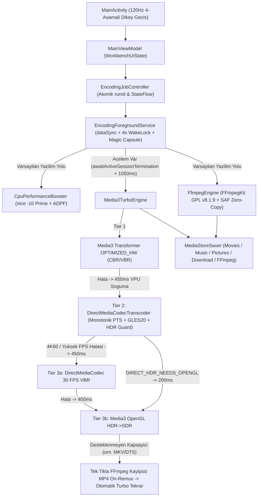

# FFmpeg Compressor & Editor — Yapay Zeka Ajanı Geliştirme ve Devir Teslim Kılavuzu (`AGENTS.md`)

Bu doküman, **`Cres246/FFmpeg-compressor-editor`** projesini devralan yapay zeka ajanlarının önceki geliştirme sürecindeki tüm mimari kararları, FFmpeg/Media3 kurallarını, çözülen hataları, kullanıcı arayüzü tercihlerini, kesinlikle yapılmaması gerekenleri ve sıradaki adımları eksiksiz şekilde okuyup kaldığı yerden devam edebilmesi için hazırlanmıştır.

---

## 1. Proje Kimliği, Kökeni ve Mevcut Durum

### 1.1 Köken (Termux Betiğinden Yerel Android Uygulamasına)
1. **Faz 1 — Termux Betiği (`~/bin/termux-file-editor`):** Proje ilk olarak Android üzerinde yerel ARM64 FFmpeg gücünü kullanan 10 modlu etkileşimli bir Bash betiği ([`betik_308d5669.txt`](public/assets/aistudio/betik_308d5669.txt), tasarım arşivi [`Android___in_Kay_ps_z_Video_D_n___m__9bf11cd7.json`](public/assets/aistudio/Android___in_Kay_ps_z_Video_D_n___m__9bf11cd7.json)) olarak 40+ revizyonla olgunlaştırıldı.
2. **Faz 2 — Yerel Android Uygulaması (`b7ecbfe` → güncel):** Betikteki tüm 2-Pass bit hızı matematiği, milisaniyelik keyframe tarayıcısı, 3 yönlü çözünürlük ölçekleyicisi ve sıfır çöp dosya (zero-bloat) kuralları birebir korunarak **Kotlin + Jetpack Compose + GPL FFmpegKit + Jetpack Media3 Transformer + Direct OpenGL/MediaCodec** tabanlı yerel bir Android uygulamasına taşındı. İlk prototipteki mavi/camgöbeği `"FFLab"` kimliği terk edilerek sıcak krem ve koyu çello kahvesi tonlarında editoryal **"FFmpeg"** tasarım sistemine geçildi.

### 1.2 Teknik Künye
* **Uygulama Kimliği & Namespace:** `applicationId = "com.aistudio.fflab.vktmpx"`, `namespace = "com.example"` ([`app/build.gradle.kts`](app/build.gradle.kts))
* **SDK & Derleme Zinciri:** `minSdk = 24` (Android 7.0), `targetSdk = 36`, `compileSdk = 36.1`, AGP `9.1.1`, Kotlin `2.4.21`, Java `11`, 16 KB sayfa hizalaması hazır (`jniLibs.useLegacyPackaging = false`) ([`gradle/libs.versions.toml`](gradle/libs.versions.toml))
* **3 Katmanlı Hibrit Medya Motoru:**
  1. **Yazılım Motoru (Varsayılan / Tam Kalite):** `dev.ffmpegkit-maintained:ffmpeg-kit-full-gpl:8.1.9` (`libx264`, `libx265`, `libmp3lame`, `ffprobe` dahil) — [`FfmpegEngine.kt`](app/src/main/java/com/example/data/FfmpegEngine.kt)
  2. **Donanım Motoru — Tier 1 & 3b:** `androidx.media3:media3-transformer:1.11.1` + `media3-effect` — [`Media3TurboEngine.kt`](app/src/main/java/com/example/data/Media3TurboEngine.kt)
  3. **Donanım Motoru — Tier 2 & 3a:** Sıfır bağımlılıklı yerel `MediaExtractor` → `MediaCodec` (HW Decoder) → `EGL14` / `GLES20` (`SurfaceTexture`) → `MediaCodec` (HW Encoder) → `MediaMuxer` hattı — [`DirectMediaCodecTranscoder.kt`](app/src/main/java/com/example/data/DirectMediaCodecTranscoder.kt)
* **Birincil Hedef Test Cihazı Profili:** **Honor (MagicOS / Android 16, Snapdragon / Qualcomm `c2.qti.*` VPU, 120Hz ekran, Honor Magic Capsule)**. Bildirim tasarımı, yenileme hızı kilidi, Prime çekirdek önceliklendirmesi ve donanım VPU soğuma süreleri bu gerçek donanım davranışlarına göre doğrulanmıştır.

### 1.3 Mevcut 11 İşleme Modu ([`MediaModels.kt`](app/src/main/java/com/example/domain/MediaModels.kt))
Termux betiğindeki 10 moda `9f271be` commit'inde **03 · Gmail (`< 25 MB`)** eklenmiş ve toplam mod sayısı 11 olmuştur:

| No | Enum (`ProcessingMode`) | Kategori | Çıktı Şablonu | Teknik Davranış | Turbo (`MediaCodec`) |
| :---: | :--- | :--- | :--- | :--- | :---: |
| **01** | `DISCORD_20MB` | Hedef Boyut | `*_H264_20MB.mp4` | `< 20 MB` gerçek 2-Pass ABR | Evet |
| **02** | `WHATSAPP_100MB` | Hedef Boyut | `*_H264_100MB.mp4` | `< 100 MB` gerçek 2-Pass ABR | Evet |
| **03** | `GMAIL_25MB` | Hedef Boyut | `*_H264_25MB.mp4` | `< 25 MB` gerçek 2-Pass ABR | Evet |
| **04** | `CUSTOM_SIZE` | Hedef Boyut | `*_<MB>MB.mp4` | Kullanıcı MB hedefi (varsayılan `8 MB`) · 2-Pass ABR | Evet |
| **05** | `TRIM_VIDEO` | Videoyu Kes | `*_Kesit*.mp4` / `*_Clip*.mp4` | Keyframe taramalı 4 alt mod (1–2 kayıpsız, 3–4 hassas CRF) | Sadece Alt Mod 3 & 4 |
| **06** | `REMUX_FORMAT` | Daha Fazla | `*_Remux.mp4` | `-sn -dn -c copy -movflags +faststart` (%100 kayıpsız kutu yenileme) | Hayır (Zaten anlık) |
| **07** | `EXTRACT_AUDIO` | Daha Fazla | `*_Orijinal.<ext>` / `*_Ses*.m4a\|mp3` | `-vn -sn -dn`; kaynak zaten hedef kodekse otomatik `-c:a copy` | Hayır |
| **08** | `AUDIO_ONLY_AAC` | Daha Fazla | `*_AAC_<k>k.mp4` | `-c:v copy -c:a aac` (Görüntü %100 kayıpsız, ses AAC; varsayılan `256k`) | Hayır |
| **09** | `VIDEO_ONLY_CRF` | Daha Fazla | `*_<CODEC>_CRF16\|20.mp4` | Video `CRF 16` (H.264) / `CRF 20` (H.265) + `-c:a copy` | Evet |
| **10** | `VIDEO_AND_AUDIO_CRF` | Daha Fazla | `*_<CODEC>_CRF16\|20_AAC_<k>k.mp4` | Video `CRF 16/20` + Ses AAC (`256k` varsayılan) | Evet |
| **11** | `CUSTOM_COMMAND` | Daha Fazla | Komutta belirtilen ad | Yapay zekadan kopyalanmış ham/çok adımlı (`&&`) FFmpeg komutları | Hayır |

---

## 2. Mimari Kararlar

### 2.1 4 Katmanlı Paket Yapısı (`app/src/main/java/com/example/`)
* **`domain/` (Saf İş Mantığı):**
  * [`MediaModels.kt`](app/src/main/java/com/example/domain/MediaModels.kt): Tüm domain modelleri, 11 mod, kesim alt modları ve `EncodingState` (`Idle`, `Running`, `Success`, `Failed`).
  * [`FfmpegMath.kt`](app/src/main/java/com/example/domain/FfmpegMath.kt): 2-Pass bit hızı hesabı, 3 yönlü çözünürlük filtreleri, keyframe ayrıştırıcısı, dosya adı ve FFmpeg argüman üreticisi (`buildFfmpegSteps`).
  * [`CustomFfmpegParser.kt`](app/src/main/java/com/example/domain/CustomFfmpegParser.kt): ChatGPT/Gemini/Claude çıktılarından doğrudan yapıştırılan Markdown bloklu, çok satırlı, değişkenli ve çok adımlı (`&&`) FFmpeg komutlarını Android kum havuzuna uyarlayan ayrıştırıcı.
  * [`AppLocalization.kt`](app/src/main/java/com/example/domain/AppLocalization.kt): `interface AppStrings` ve `AppLanguageController` üzerinden 0ms gecikmeli, Activity yeniden başlatmayan canlı Türkçe/İngilizce dil sistemi (`SYSTEM` / `TR` / `EN`).
* **`data/` (Motorlar ve Depolama):**
  * [`FfmpegEngine.kt`](app/src/main/java/com/example/data/FfmpegEngine.kt), [`Media3TurboEngine.kt`](app/src/main/java/com/example/data/Media3TurboEngine.kt), [`DirectMediaCodecTranscoder.kt`](app/src/main/java/com/example/data/DirectMediaCodecTranscoder.kt), [`MediaStoreSaver.kt`](app/src/main/java/com/example/data/MediaStoreSaver.kt) ve DataStore tabanlı [`PreferencesRepository.kt`](app/src/main/java/com/example/data/PreferencesRepository.kt) (son 25 çıktıyı TSV olarak saklar).
* **`service/` (Arka Plan Yaşam Döngüsü ve Donanım Yönetimi):**
  * [`EncodingForegroundService.kt`](app/src/main/java/com/example/service/EncodingForegroundService.kt) & süreç kapsamlı [`EncodingJobController`](app/src/main/java/com/example/service/EncodingForegroundService.kt).
  * [`CpuPerformanceBooster.kt`](app/src/main/java/com/example/service/CpuPerformanceBooster.kt): `/proc/self/task/<tid>/stat` profili ile en ağır C++ FFmpeg iş parçacığını `nice -10` Prime çekirdeğine ve Android 12+/14+ ADPF `PerformanceHintManager` oturumuna bağlar.
* **`ui/` (Compose Ekranları & ViewModel):**
  * [`MainActivity.kt`](app/src/main/java/com/example/MainActivity.kt), [`MainViewModel.kt`](app/src/main/java/com/example/ui/MainViewModel.kt), `ui/theme/` (`Color.kt`, `Theme.kt`, `Type.kt`), `ui/components/` (`MediaHeroCard.kt`, `ModeGridSection.kt`, `EncoderControls.kt`, `TrimConfigSection.kt`) ve `ui/screens/` (`ModeConfigScreen.kt`, `ProcessingScreen.kt`, `TurboProcessingScreen.kt`, `HistorySheet.kt`).

### 2.2 Sıfır İzinli, Sıfır Kopyalamalı (Zero-Copy) Girdi ve Kum Havuzu Çıktısı
* Depolama okuma izni **istenmez**. Photo Picker (`PickVisualMedia`), SAF (`OpenDocument` + kalıcı okuma izni) ve `ACTION_SEND`/`ACTION_VIEW` URI'leri doğrudan `FFmpegKitConfig.getSafParameterForRead(context, uri)` üzerinden okunur.
* Çıktılar ve 2-Pass `.log`/`.mbtree`/`.cutree` dosyaları `context.cacheDir/fflab_work_<timestamp>` içine yazılır; tamamlandığında [`MediaStoreSaver.saveToPublicStorage`](app/src/main/java/com/example/data/MediaStoreSaver.kt) ile `Movies/FFmpeg`, `Music/FFmpeg`, `Pictures/FFmpeg` veya `Download/FFmpeg` klasörüne aktarılır ve `finally` bloğunda geçici klasör tamamen silinir. Açılışta `cleanupOrphanTempDirs` çökme kalıntılarını temizler.

### 2.3 Atomik `runId` ve `Idle`'a Düşmeyen Geçişler
* `EncodingJobController`, her yeni işte `activeRunId` sayacını atomik artırır ve eski işi `cancelledRunId` olarak işaretler; geç gelen yerel geri çağrımlar iptal edilmiş işin UI durumunu asla açamaz.
* `startStandardRun`, `switchActiveRunToTurbo` ve `switchActiveRunToRemuxThenTurbo` arada `EncodingState.Idle` yaymadan doğrudan yeni `Running` durumuna geçer; böylece `880ms` 120Hz dikey kayma animasyonları anında ve sıfır titremeyle oynar.

### 2.4 Android 16 Promoted Ongoing & Honor Magic Capsule
* [`EncodingForegroundService.buildNotification`](app/src/main/java/com/example/service/EncodingForegroundService.kt) sol ikon yuvasında özel statik `1/1`, `1/2`, `2/2`, `1/3`, `2/3`, `3/3` vektörlerini (`ic_stat_pass_*`), sağ yuvada ise MagicOS'un kaydırmaması için kesinlikle `<= 4` karakterlik yüzde etiketini (`"%25"` / `"25%"`) kullanır.

---

## 3. FFmpeg Kuralları ve Değişmezleri (Invariants)

1. **Gerçek 2-Pass ABR Bit Hızı Formülü ([`FfmpegMath.calculateTwoPassVideoBitrateKbps`](app/src/main/java/com/example/domain/FfmpegMath.kt)):**
   * `totalKb = targetMb * 8000.0 * 0.96`, `vkbps = floor((totalKb / safeDur) - audioBitrateKbps).coerceAtLeast(80)`.
   * Ondalık `8000` + `%4` (`0.96`) güvenlik payı çıktıyı hem ikili MiB hem ondalık MB sınırlarının (Discord `20 MB`, Gmail `25 MB`, WhatsApp `100 MB`) altında tutar.
   * Düşük bit hızı uyarısı `<= 120 kbps`; `30 FPS + 720p` önerisi `(dur >= 60s && vkbps < [H.265: 950 | H.264: 1400]) || vkbps < 650`.
   * Kullanıcı dokunmadıysa (`*Touched == false`): `<= 3 MB` → `64k` ses (aksi `128k`); `< 5 MB` → `30 FPS` + `720p` (kaynak kısa kenarı `> 720` ise).
2. **Kodek, CRF, `hvc1` ve Bit Derinliği:**
   * `H.264 (libx264)` → **`CRF 16`** ve **kesinlikle 8-bit (`yuv420p`)** (`MainViewModel.updateBitDepth` ve UI 10-bit H.264'ü engeller).
   * `H.265 (libx265)` → **`CRF 20`**, kaynak `10bit`/`12bit` ise varsayılan `10-bit (yuv420p10le)`, tüm son çıktılarda `-tag:v hvc1`, 2-Pass'ta `-x265-params log-level=warning:pools=+:pass=1|2:stats=<passLog>.log`.
3. **3 Yönlü Çözünürlük Ölçekleme ve `EVEN_VF` ([`FfmpegMath.buildScaleFilter`](app/src/main/java/com/example/domain/FfmpegMath.kt)):**
   * Dikey (`height > width`): `scale=<targetShort>:-2`
   * Geniş sinema (`width * 9L > height * 16L`, ör. `3840×1600`): `scale=<maxLong>:-2` (`1920×800`, genişlik taşmasını önler)
   * Standart (`16:9` / `4:3` / `1:1`): `scale=-2:<targetShort>`
   * Orijinal çözünürlükte tek sayılı kenar varsa: `scale=trunc(iw/2)*2:trunc(ih/2)*2`
4. **Keyframe Tarama ve `+0.005s` Tamponu:**
   * `ffprobe -show_packets -read_intervals` ile kare çözmeden tarama yapılır; yoğun 1s-GOP videolarda `selectCenteredKeyframes` hedef etrafından simetrik en fazla 12 keyframe seçer.
   * Başlangıç keyframe değerine `-noaccurate_seek` sırasında bir önceki GOP'a düşmemek için daima **`+0.005s` (+5ms)** eklenir; bitiş ham `nextKf` olarak kalır.
   * Alt Mod 1–2 (kayıpsız): `-noaccurate_seek -ss ... -to ... -i ... -avoid_negative_ts make_zero`. Alt Mod 3–4 (hassas CRF): `-noaccurate_seek` olmadan girdi öncesi `-ss` / `-to`.
5. **Akış Temizliği ve Kapak Resmi Koruması:**
   * Her video/ses komutunda `-sn -dn` ve MP4'lerde `-movflags +faststart` eklenir.
   * `FfmpegEngine.probeMedia`, birincil video akışını seçerken `disposition.attached_pic != 1` kontrolüyle gömülü kapak resimlerini atlar.
   * Ses tavanları: AAC `32..768 kbps`, MP3 (`libmp3lame`) `32..320 kbps`.
6. **AI Uyumlu Özel Komut Ayrıştırıcısı ([`CustomFfmpegParser.kt`](app/src/main/java/com/example/domain/CustomFfmpegParser.kt)):**
   * Markdown çitlerini, açıklamaları, yorumları, kabuk işaretlerini, akıllı tırnakları/uzun tireleri, çok satırlı devam karakterlerini (`\`, `^`, `` ` ``), değişkenleri ve `rm`/`del` satırlarını temizler; Pass 1 `/dev/null` hatalarını (`-f mp4`, `-movflags`) düzeltir; `palette.png` gibi ara dosyaları `consumedIntermediateFiles` içinde koruyup Galeri'ye çöp kaydetmez.

---

## 4. Media3 Transformer & `DirectMediaCodecTranscoder` ("Turbo Modu") Kuralları

1. **Güvenli FFmpeg → MediaCodec El Değiştirme ([`EncodingForegroundService.kt`](app/src/main/java/com/example/service/EncodingForegroundService.kt)):**
   * `cpuBooster.stop()` + `THREAD_PRIORITY_DEFAULT` → `previousJob.cancelAndJoin(450ms)` → **`FfmpegEngine.awaitActiveSessionTermination(5_000L)`** → `1_050ms` geçiş beklemesi (880ms 120Hz kayma animasyonunun tamamlanması için).
2. **Katı Ondalık MB & AAC Sızıntı Koruması ([`Media3TurboEngine.computeTurboBitratePlan`](app/src/main/java/com/example/data/Media3TurboEngine.kt)):**
   * Hedef boyut modlarında `targetMb * 1_000_000.0` byte hesabı, `%1.8 + 64 KB` mux payı, CBR `0.955` / VBR `0.885` marjı (CBR→VBR yedekte `0.93x`).
   * Kaynak AAC hedef bit hızından yüksekse Media3'ün sessiz transmux yapmasını engellemek için [`ForceAudioEncodeProcessor`](app/src/main/java/com/example/data/Media3TurboEngine.kt) takılır.
   * Platform AAC kodlayıcısı kanal başına `160 kbps` (stereo max `320k`) ile sınırlanır (`clampBitrateForChannels`).
3. **4 Katmanlı Kurtarma Zinciri:**
   * **Tier 1 (Media3 `OPTIMIZED_HW`):** `<= 1080p` için `DefaultEncoderFactory` + sonlu `operatingRate`; `> 1080p` için Qualcomm C2 uyumlu `CleanHardwareEncoderFactory`.
   * **`450ms` VPU Soğuma** → **Tier 2 ([`DirectMediaCodecTranscoder`](app/src/main/java/com/example/data/DirectMediaCodecTranscoder.kt)):** Kayıpsız kesilmiş kliplerdeki bozuk `elst`/PTS değerlerini temizleyen monotonik PTS + GLES20 Surface + izole `.m4a` ses ön-geçişi + kesirli 30 FPS akümülatörü (`TargetFpsFrameDropper`) + kesimsiz ortak A/V senkron tabanı (`resolveUntrimmedAvBaselineUs`) + erken/çözücü sonrası HDR renk koruyucusu (`ERROR_HDR_NEEDS_OPENGL`).
   * **Tier 3a (Direct 30 FPS VBR):** Yalnızca yüksek FPS/4K VPU tavanı aşımında ve HDR değilse çalışır.
   * **Tier 3b (Media3 OpenGL HDR→SDR):** 10-bit HDR10/HLG/Dolby Vision akışları ve son çare uyumluluk için.
   * **Kullanıcı Kurtarma:** Hâlâ kapsayıcı uyumsuzluğu varsa tek tıkla FFmpeg `-c copy` MP4 ön-remux + otomatik kadran ekranına geri dönüş (`runRemuxThenTurboPipeline`), olmazsa tek tıkla FFmpeg (`Fast` veya seçili preset).

---

## 5. Çözülen Kritik Buglar (Özet)

* **SAF FD Kapanması (`b7ecbfe`):** 2. geçişte `resolveInputPath` her adım başında taze çağrılır.
* **Tek Piksel & 21:9 Ölçek Taşması (`b7ecbfe`):** `EVEN_VF` + 3 yönlü `buildScaleFilter`.
* **Kayıpsız Kesim GOP Geri Sıçraması (`b7ecbfe`):** Başlangıç keyframe'ine `+0.005s` tamponu.
* **Honor Magic Capsule Metin Kayması (`b7ecbfe`):** `shortCriticalText <= 4` karakter + özel `ic_stat_pass_*` vektörleri.
* **CI `debug.keystore` Hatası (`ed21220`):** `.github/workflows/build-apk.yml` içinde otomatik `keytool` üretimi.
* **ART `java.lang.VerifyError` Çökmesi (`f66970c`):** `data class AppStrings` 255 parametre sınırını aştığı için `interface AppStrings` + tekil `object TurkishStrings`/`EnglishStrings` mimarisine geçildi.
* **Gömülü Kapak Resmi Video Sanılması (`cbfd66a`):** `disposition.attached_pic != 1` filtresi.
* **Qualcomm `c2.qti.avc.encoder` `operating-rate=2147483647` & VPU Çakışması (`0605c2d`, `136fbbc`):** `CleanHardwareEncoderFactory`, sonlu `delegateOpRate`, katmanlar arası `450ms` soğuma, `awaitActiveSessionTermination` ve `DirectMediaCodecTranscoder`.
* **API 24–28 Görsel/GIF `FileProvider` Eksikliği & `DirectMediaCodecTranscoder` Sertleştirmesi (bu dal):** `file_paths.xml` içine `Pictures/FFmpeg/` ve `Download/FFmpeg/` eklendi; `DirectMediaCodecTranscoder` için HDR koruması, 50/48 FPS uyumlu kesirli 30 FPS akümülatörü, kesimsiz ortak A/V tabanı, `openExtractor` sızıntı koruması ve birim testleri eklendi.

---

## 6. Kullanıcı Arayüzü (UI/UX) Tercihleri

* **Tema:** Yalnızca sıcak gündüz **"Cream & Cello Dark-Brown Editorial"** paleti (`CreamBg #FAF6F0`, `IvorySurface #FFFDF9`, `LinenSurface #F3ECE2`, `CelloBrown #562812`, `CelloAmber #844B27`, `AntiqueSage #3B5E46` kayıpsız, `SiennaError #A63624` kayıplı/hata/redline). Karanlık mod, saf `#FFFFFF`/`#000000` veya ağır gölgeler kullanılmaz.
* **4 Fontlu Tipografi (`Type.kt`):** `Space Grotesk` (büyük yüzdeler ve ana başlıklar), `Plus Jakarta Sans` (gövde ve butonlar), `JetBrains Mono` (teknik veriler, komutlar, rozetler), `Playfair Display Italic SemiBold` (yalnızca kategori başlıkları, jenerik alt başlıkları, aktif preset ve Turbo koruma notu gibi seçkin editoryal vurgular).
* **İkonlar:** Discord, WhatsApp ve Gmail için özel marka vektörleri (`ic_brand_*.xml`), `CelloBrown` renginde.
* **Hareket ve Geçiş:** `MainActivity.requestHighestRefreshRate()` ile 120Hz kilitli; 4 aşama arası `880ms` dikey itme (`CubicBezierEasing(0.68f, 0f, 0.32f, 1f)`), çıkış ekranları için `cached*` durum önbellekleme.
* **Sadelik:** Mükerrer özet çipleri veya zaten altında bulunan kontrolleri tekrarlayan uyarı içi aksiyon butonları eklenmez.

---

## 7. Kesinlikle Yapılmaması Gerekenler (Kırmızı Çizgiler)

1. **`AppStrings` veya büyük yapılandırma sınıflarını ASLA `data class` yapmayın** (`>255` kurucu parametresi ART `VerifyError` üretir).
2. **`FFmpegKitConfig.getSafParameterForRead` token'ını birden fazla adımda ASLA yeniden kullanmayın** ve büyük kaynak videoları `cacheDir`'e kopyalamayın.
3. **`FFmpegKit.cancel()`'ı ASLA senkron varsaymayın;** MediaCodec öncesi mutlaka `awaitActiveSessionTermination()` bekleyin.
4. **Başarısız bir `MediaCodec` denemesinden sonra `0ms` ile tekrar denemeyin;** yarım dosyayı silip C2 HAL için `400–450ms` bekleyin.
5. **Media3 `DefaultEncoderFactory` (delegeler dahil) üzerinde `setEncoderPerformanceParameters`'ı ASLA boş bırakmayın** (`INT_MAX` Qualcomm'u çökertir).
6. **Media3'te AAC→AAC yeniden kodlama için `ForceAudioEncodeProcessor`'ı ASLA kaldırmayın** ve platform AAC kodlayıcısına `160 kbps/kanal` (stereo `320k`) üstü vermeyin.
7. **`SurfaceTexture.setOnFrameAvailableListener`'ı ayrı bir `HandlerThread` olmadan ASLA kullanmayın** (deadlock).
8. **Coroutine `catch (t: Throwable)` bloklarında `CancellationException`'ı ASLA yutmayın.**
9. **Turbo (MediaCodec) modunda `CpuPerformanceBooster`'ı ASLA açık bırakmayın.**
10. **[`app/build.gradle.kts`](app/build.gradle.kts) içindeki `signingConfigs` (`release` ve `debugConfig`) bloklarını ASLA silmeyin veya değiştirmeyin** (AI Studio için zorunlu).
11. **H.264 10-bit seçeneğini UI'da tekrar açmayın;** metinleri `stringResource()` yerine `AppStrings` üzerinden verin; Magic Capsule `shortCriticalText`'i 4 karakterin üzerine çıkarmayın.

---

## 8. Sıradaki Yapılacaklar (Güncel Yol Haritası)

* [x] **P0:** `file_paths.xml` içine `Pictures/FFmpeg/` ve `Download/FFmpeg/` köklerinin eklenmesi ve API 24–28 `MediaStoreSaver` hizalanması.
* [x] **P1:** `DirectMediaCodecTranscoder` HDR renk koruması, 50/48 FPS uyumlu kesirli 30 FPS akümülatörü (`TargetFpsFrameDropper`), kesimsiz ortak A/V senkron tabanı ve `openExtractor` kaynak sızıntı koruması.
* [x] **P2:** `OpenSourceCreditsDialog`'a AndroidX Media3 Transformer eklenmesi, `metadata.json`'ın 11 mod olarak güncellenmesi ve kullanılmayan ~813 KB eski FFLab ikonlarının (`ic_fflab_logo.png`, `ic_fflab_cream_icon_1795406018575.jpg`) kaldırılması.
* [x] **P3 (Kısmi):** `DirectMediaCodecTranscoderTest` ve `Media3TurboEngineTest` birim testlerinin eklenmesi ve GitHub Actions `build-apk.yml` içine `testDebugUnitTest` kapısının eklenmesi.
* [ ] **Sıradaki 1 — Compose UI & `MainViewModel` Testleri:** Ekranlardaki mevcut 40+ `Modifier.testTag(...)` kullanılarak Robolectric + `compose-ui-test-junit4` ile uçtan uca mod seçimi, kesim aralığı doğrulaması ve dil değişimi testlerinin yazılması.
* [ ] **Sıradaki 2 — `HistorySheet` Tekil Kayıt Yönetimi:** Çıktı geçmişinde tekil satır silme ve galeriden silinmiş URI'lerin temiz şekilde işaretlenmesi/gizlenmesi.
* [ ] **Sıradaki 3 — Sürüm Senkronizasyonu:** `app/build.gradle.kts` (`versionCode` / `versionName`) ile `.github/workflows/build-apk.yml` (`SURUM_ETIKETI`) sürüm otomasyonunun GitHub Releases etiketleriyle hizalanması.
* [ ] **Sıradaki 4 — Opsiyonel 10-Bit Direct HDR Desteği:** Eğer gelecekte Media3'ün başarısız olduğu HDR10 kayıpsız kesim klipleri çıkarsa, `DirectMediaCodecTranscoder` için `EGL_OPENGL_ES3_BIT` + `RGBA1010102` + `HEVCProfileMain10` renk boru hattı eklenmesi.
