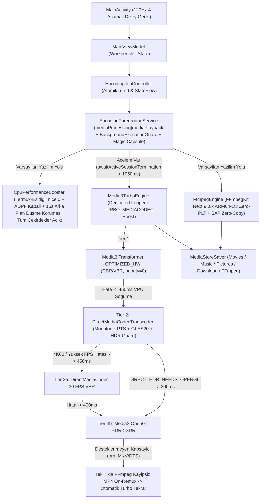

## 1. Proje Kimliği, Kökeni ve Mevcut Durum

### 1.1 Köken (Termux Betiğinden Yerel Android Uygulamasına)
1. **Faz 1 — Termux Betiği (`~/bin/termux-file-editor`):** Proje ilk olarak Android üzerinde yerel ARM64 FFmpeg gücünü kullanan 10 modlu etkileşimli bir Bash betiği ([`betik_308d5669.txt`](public/assets/aistudio/betik_308d5669.txt), tasarım arşivi [`Android___in_Kay_ps_z_Video_D_n___m__9bf11cd7.json`](public/assets/aistudio/Android___in_Kay_ps_z_Video_D_n___m__9bf11cd7.json)) olarak 40+ revizyonla olgunlaştırıldı.
2. **Faz 2 — Yerel Android Uygulaması (`b7ecbfe` → güncel):** Betikteki tüm 2-Pass bit hızı matematiği, milisaniyelik keyframe tarayıcısı, 3 yönlü çözünürlük ölçekleyicisi ve sıfır çöp dosya (zero-bloat) kuralları birebir korunarak **Kotlin + Jetpack Compose + GPL FFmpegKit + Jetpack Media3 Transformer + Direct OpenGL/MediaCodec** tabanlı yerel bir Android uygulamasına taşındı. İlk prototipteki mavi/camgöbeği `"FFLab"` kimliği terk edilerek sıcak krem ve koyu çello kahvesi tonlarında editoryal **"FFmpeg"** tasarım sistemine geçildi.

### 1.2 Teknik Künye
* **Uygulama Kimliği & Namespace:** `applicationId = "com.aistudio.fflab.vktmpx"`, `namespace = "com.example"` ([`app/build.gradle.kts`](app/build.gradle.kts))
* **SDK & Derleme Zinciri:** `minSdk = 24` (Android 7.0), `targetSdk = 36`, `compileSdk = 36.1`, AGP `9.1.1`, Kotlin `2.4.21`, Java `11`, 16 KB sayfa hizalaması hazır (`jniLibs.useLegacyPackaging = false`) ([`gradle/libs.versions.toml`](gradle/libs.versions.toml))
* **3 Katmanlı Hibrit Medya Motoru:**
  1. **Yazılım Motoru (Varsayılan / Tam Kalite):** Resmi **`arthenica/ffmpeg-kit-next`** (FFmpeg 9.0.x + `libx264`, `libx265`, `libmp3lame`, `ffprobe`, `arm64-v8a` `-O3` runtime-dispatched `NEON/DotProd/I8MM`, Nix `./nix-android.sh` ile GitHub Actions üzerinde tek motor olarak derlenir; yalnızca Nix'siz AI Studio önizlemesinde `dev.ffmpegkit-maintained:ffmpeg-kit-full-gpl:8.1.9` yerel geliştirme bağımlılığı devrededir) — [`FfmpegEngine.kt`](app/src/main/java/com/example/data/FfmpegEngine.kt)
  2. **Donanım Motoru — Tier 1 & 3b:** `androidx.media3:media3-transformer:1.11.1` + `media3-effect` — [`Media3TurboEngine.kt`](app/src/main/java/com/example/data/Media3TurboEngine.kt)
  3. **Donanım Motoru — Tier 2 & 3a:** Sıfır bağımlılıklı yerel `MediaExtractor` → `MediaCodec` (HW Decoder) → `EGL14` / `GLES20` (`SurfaceTexture`) → `MediaCodec` (HW Encoder) → `MediaMuxer` hattı — [`DirectMediaCodecTranscoder.kt`](app/src/main/java/com/example/data/DirectMediaCodecTranscoder.kt)
* **Birincil Hedef Test Cihazı Profili:** **Honor (MagicOS / Android 16, Snapdragon / Qualcomm `c2.qti.*` VPU, 120Hz ekran, Honor Magic Capsule)**. Bildirim tasarımı, yenileme hızı kilidi, Prime çekirdek önceliklendirmesi ve donanım VPU soğuma süreleri bu gerçek donanım davranışlarına göre doğrulanmıştır.

### 1.3 Mevcut 11 İşleme Modu ([`MediaModels.kt`](app/src/main/java/com/example/domain/MediaModels.kt))
Termux betiğindeki 10 moda `9f271be` commit'inde **03 · Gmail (`< 25 MB`)** eklenmiş ve toplam mod sayısı 11 olmuştur:

| No | Enum (`ProcessingMode`) | Kategori | Çıktı Şablonu | Teknik Davranış | Turbo (`MediaCodec`) |
| :---: | :--- | :--- | :--- | :--- | :---: |
| **01** | `DISCORD_20MB` | Hedef Boyut | `*_H264_20MB.mp4` | `< 20 MB` gerçek 2-Pass ABR | Evet |
| **02** | `WHATSAPP_100MB` | Hedef Boyut | `*_H264_100MB.mp4` | `< 100 MB` gerçek 2-Pass ABR | Evet |
| **03** | `GMAIL_25MB` | Hedef Boyut | `*_H264_25MB.mp4` | `< 25 MB` gerçek 2-Pass ABR | Evet |
| **04** | `CUSTOM_SIZE` | Hedef Boyut | `*_<MB>MB.mp4` | Kullanıcı MB hedefi (varsayılan `8 MB`) · 2-Pass ABR | Evet |
| **05** | `TRIM_VIDEO` | Videoyu Kes | `*_Kesit*.mp4` / `*_Clip*.mp4` | Keyframe taramalı 4 alt mod (1–2 kayıpsız, 3–4 hassas CRF) | Sadece Alt Mod 3 & 4 |
| **06** | `REMUX_FORMAT` | Daha Fazla | `*_Remux.mp4` | `-sn -dn -c copy -movflags +faststart` (%100 kayıpsız kutu yenileme) | Hayır (Zaten anlık) |
| **07** | `EXTRACT_AUDIO` | Daha Fazla | `*_Orijinal.<ext>` / `*_Ses*.m4a\|mp3` | `-vn -sn -dn`; kaynak zaten hedef kodekse otomatik `-c:a copy` | Hayır |
| **08** | `AUDIO_ONLY_AAC` | Daha Fazla | `*_AAC_<k>k.mp4` | `-c:v copy -c:a aac` (Görüntü %100 kayıpsız, ses AAC; varsayılan `256k`) | Hayır |
| **09** | `VIDEO_ONLY_CRF` | Daha Fazla | `*_<CODEC>_CRF16\|20.mp4` | Video `CRF 16` (H.264) / `CRF 20` (H.265) + `-c:a copy` | Evet |
| **10** | `VIDEO_AND_AUDIO_CRF` | Daha Fazla | `*_<CODEC>_CRF16\|20_AAC_<k>k.mp4` | Video `CRF 16/20` + Ses AAC (`256k` varsayılan) | Evet |
| **11** | `CUSTOM_COMMAND` | Daha Fazla | Komutta belirtilen ad | Yapay zekadan kopyalanmış ham/çok adımlı (`&&`) FFmpeg komutları | Hayır |

---

## 2. Mimari Kararlar

### 2.1 4 Katmanlı Paket Yapısı (`app/src/main/java/com/example/`)
* **`domain/` (Saf İş Mantığı):**
  * [`MediaModels.kt`](app/src/main/java/com/example/domain/MediaModels.kt): Tüm domain modelleri, 11 mod, kesim alt modları ve `EncodingState` (`Idle`, `Running`, `Success`, `Failed`).
  * [`FfmpegMath.kt`](app/src/main/java/com/example/domain/FfmpegMath.kt): 2-Pass bit hızı hesabı, 3 yönlü çözünürlük filtreleri, keyframe ayrıştırıcısı, dosya adı ve FFmpeg argüman üreticisi (`buildFfmpegSteps`).
  * [`CustomFfmpegParser.kt`](app/src/main/java/com/example/domain/CustomFfmpegParser.kt): ChatGPT/Gemini/Claude çıktılarından doğrudan yapıştırılan Markdown bloklu, çok satırlı, değişkenli ve çok adımlı (`&&`) FFmpeg komutlarını Android kum havuzuna uyarlayan ayrıştırıcı.
  * [`AppLocalization.kt`](app/src/main/java/com/example/domain/AppLocalization.kt): `interface AppStrings` ve `AppLanguageController` üzerinden 0ms gecikmeli, Activity yeniden başlatmayan canlı Türkçe/İngilizce dil sistemi (`SYSTEM` / `TR` / `EN`).
* **`data/` (Motorlar ve Depolama):**
  * [`FfmpegEngine.kt`](app/src/main/java/com/example/data/FfmpegEngine.kt), [`VideoFrameScrubber.kt`](app/src/main/java/com/example/data/VideoFrameScrubber.kt), [`Media3TurboEngine.kt`](app/src/main/java/com/example/data/Media3TurboEngine.kt), [`DirectMediaCodecTranscoder.kt`](app/src/main/java/com/example/data/DirectMediaCodecTranscoder.kt), [`MediaStoreSaver.kt`](app/src/main/java/com/example/data/MediaStoreSaver.kt) ve DataStore tabanlı [`PreferencesRepository.kt`](app/src/main/java/com/example/data/PreferencesRepository.kt) (son 25 çıktıyı TSV olarak saklar).
* **`service/` (Arka Plan Yaşam Döngüsü ve Donanım Yönetimi):**
  * [`EncodingForegroundService.kt`](app/src/main/java/com/example/service/EncodingForegroundService.kt) & süreç kapsamlı [`EncodingJobController`](app/src/main/java/com/example/service/EncodingForegroundService.kt): `mediaProcessing|mediaPlayback|dataSync` FGS, `stopWithTask="false"`, `FOREGROUND_SERVICE_IMMEDIATE`, Android 15+ `onTimeout()` ve `onTaskRemoved()` korumalı servis.
  * [`BackgroundExecutionGuard.kt`](app/src/main/java/com/example/service/BackgroundExecutionGuard.kt): Sıfır müdahaleli sessiz `AudioTrack` (`MODE_STATIC` saf 0x0000 PCM, AudioFocus/MediaSession almadan OEM `HwFastFreezer`/`iAware`/`Millet`/`Hans` dondurucusunu aşar), Honor 60 dk kuralına uyumlu 15 dk kayan/5 dk yenilenen `PARTIAL_WAKE_LOCK` ve 2 sn öz-iyileştirmeli bekçi döngüsü.
  * [`CpuPerformanceBooster.kt`](app/src/main/java/com/example/service/CpuPerformanceBooster.kt): İki farklı modlu zamanlayıcı: (1) **`FFMPEG_SOFTWARE` (Termux Eşitliği):** Tüm çekirdekler açık (sıfır `sched_setaffinity`), **ADPF kapalı** (`uclamp.min` voltaj artışı ve erken MagicOS/Snapdragon 2. geçiş termal kısıtlaması önlenir), tüm kodlayıcı iş parçacıkları nötr Linux `nice 0` (`THREAD_PRIORITY_DEFAULT`) önceliğinde kalır; yalnızca `15s`'de bir `/proc/self/task` üzerinden OEM arka planda `> 0` (`+10`) önceliğe düşürürse `0`'a geri çeker (ön planda sıfır `setThreadPriority` ve sıfır `/stat` okuma maliyeti). (2) **`TURBO_MEDIACODEC`:** Donanım VPU besleyici thread'leri için `URGENT_DISPLAY`/`DISPLAY` ve dengeli `16ms/17ms` ADPF oturumunu korur.
* **`ui/` (Compose Ekranları & ViewModel):**
  * [`MainActivity.kt`](app/src/main/java/com/example/MainActivity.kt), [`MainViewModel.kt`](app/src/main/java/com/example/ui/MainViewModel.kt), `ui/theme/` (`Color.kt`, `Theme.kt`, `Type.kt`), `ui/components/` (`MediaHeroCard.kt`, `ModeGridSection.kt`, `EncoderControls.kt`, `TrimConfigSection.kt`) ve `ui/screens/` (`ModeConfigScreen.kt`, `ProcessingScreen.kt`, `TurboProcessingScreen.kt`, `HistorySheet.kt`).

### 2.2 Sıfır İzinli, Sıfır Kopyalı (`saf:`) Girdi ve Kum Havuzu Çıktısı
* Depolama okuma izni **istenmez**. Photo Picker (`PickVisualMedia`), SAF (`OpenDocument` + kalıcı okuma izni) ve `ACTION_SEND`/`ACTION_VIEW` URI'leri kullanılır.
* **Saf Sıfır Kopya (`saf:`) Kuralı:** Girdi videoları `cacheDir`'e **ASLA** kopyalanmaz; her FFmpeg adımının başında taze `FFmpegKitConfig.getSafParameterForRead(context, uri)` açılır (`saf:` dosya tanımlayıcısı FFmpeg adımı bitince kapandığından 2. geçişte taze çağrılır). *(Not: Daha önce `LocalInputStager` ile `cacheDir`'e kopyalayıp Page Cache'ten okuma deneyi gerçek Honor UFS cihazında 5 GB 4K film üzerinde test edilmiş ve **%0.0 hız farkı** verdiği kanıtlanmıştır; gereksiz 5 GB yazma yükü oluşturduğundan özellik tamamen kaldırılmıştır.)*
* Çıktılar ve 2-Pass `.log`/`.mbtree`/`.cutree` dosyaları `context.cacheDir/fflab_work_<timestamp>` içine yazılır; işlem bittiğinde, iptal edildiğinde veya hata aldığında `finally` bloğunda `workDir.deleteRecursively()` ile anında silinir. Tamamlanan çıktı [`MediaStoreSaver.saveToPublicStorage`](app/src/main/java/com/example/data/MediaStoreSaver.kt) ile `Movies/FFmpeg`, `Music/FFmpeg`, `Pictures/FFmpeg` veya `Download/FFmpeg` klasörüne aktarılır.

### 2.3 Atomik `runId` ve `Idle`'a Düşmeyen Geçişler
* `EncodingJobController`, her yeni işte `activeRunId` sayacını atomik artırır ve eski işi `cancelledRunId` olarak işaretler; geç gelen yerel geri çağrımlar iptal edilmiş işin UI durumunu asla açamaz.
* `startStandardRun`, `switchActiveRunToTurbo` ve `switchActiveRunToRemuxThenTurbo` arada `EncodingState.Idle` yaymadan doğrudan yeni `Running` durumuna geçer; böylece `880ms` 120Hz dikey kayma animasyonları anında ve sıfır titremeyle oynar.

### 2.4 Android 16 Promoted Ongoing & Honor Magic Capsule
* [`EncodingForegroundService.buildNotification`](app/src/main/java/com/example/service/EncodingForegroundService.kt) sol ikon yuvasında özel statik `1/1`, `1/2`, `2/2`, `1/3`, `2/3`, `3/3` vektörlerini (`ic_stat_pass_*`), sağ yuvada ise MagicOS'un kaydırmaması için kesinlikle `<= 4` karakterlik yüzde etiketini (`"%25"` / `"25%"`) kullanır.

---

